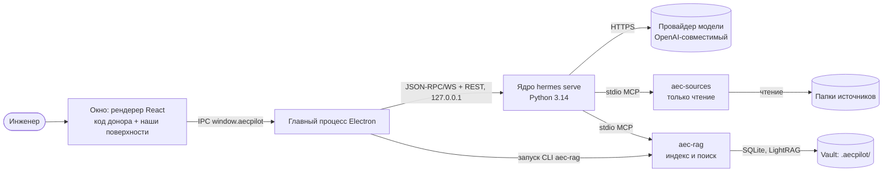
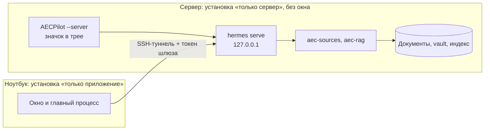

# Архитектура — AECPilot

Status: approved 2026-10-26

!!! note "Откуда этот документ"
    Технические решения прежнего `PLAN.md` (утверждались владельцем 2026-07…2026-10-22)
    перенесены сюда и в [журнал решений](decisions/index.md) 2026-10-26 при переходе на
    плагин studio. Полное обоснование, замеры и разборы релизов остаются в
    [plan-details.md](plan-details.md); проверенные факты о ядре и доноре — в
    [core-facts.md](core-facts.md); угрозы и принятые риски — в
    [THREAT_MODEL.md](THREAT_MODEL.md).

## Big picture

AECPilot — настольное приложение на Electron. Окно (рендерер) рисует интерфейс, но само
ни с чем внешним не говорит: все запросы идут через главный процесс (main). Главный
процесс запускает агентное ядро hermes-agent отдельным процессом `hermes serve` на
127.0.0.1 и держит с ним одно соединение (JSON-RPC по WebSocket плюс REST того же
процесса). Ядро ведёт разговор с моделью и вызывает инструменты; наши инструменты для
документов проекта — MCP-серверы, которые ядро запускает само. Всё, что знает проект, лежит
файлами в его папке (vault): заметки, вики и индекс в `.aecpilot/`.

Как читать: прямоугольники — процессы, цилиндры — данные; подпись стрелки — что по ней
идёт. Путь одного вопроса: инженер пишет в окне → окно отдаёт вызов главному процессу →
главный процесс передаёт его ядру → ядро просит модель ответить, модель вызывает
инструмент `rag_query` сервера `aec-rag` → тот ищет фрагменты в индексе проекта и
возвращает их с местом в файле → модель пишет ответ со ссылками → ответ потоком событий
возвращается в окно, и щелчок по ссылке открывает документ во встроенном просмотрщике.
Индексацию главный процесс запускает напрямую тем же движком `aec-rag` (команда CLI), а не
через агента: она идёт минутами и не должна занимать разговор.

Второй вариант размещения — «сервер и клиент» (UR25): ядро, MCP-серверы, vault и индекс
стоят на машине с документами, а ноутбук держит только окно и приходит к шлюзу ядра по
SSH-туннелю. Шлюз в обоих вариантах слушает только 127.0.0.1 (C11).

## Parts

| Part | Responsibility | Built with | Code | Page |
|---|---|---|---|---|
| Главный процесс | запуск ядра и соединение с ним, проверка каждого вызова из окна, файловые операции, проект и источники, индексация, расписание сканирования, ключи в safeStorage, трей сервера | Electron 43, TypeScript | `apps/desktop/src/main/` | [Главный процесс](components/main-process.md) |
| Мост preload | единственный API окна `window.aecpilot` поверх IPC | Electron contextBridge | `apps/desktop/src/preload/` | [Главный процесс](components/main-process.md) |
| Рендерер: зона донора | интерфейс Hermes Desktop: чат, сессии, настройки, специалисты, предпросмотр, доска | React 19, Tailwind v4, shadcn/Radix, nanostores, React Query | `apps/desktop/src/renderer/src/donor/` | [Окно приложения](components/renderer.md) |
| Рендерер: наши поверхности | проводник проекта и источников, просмотрщики PDF/DOCX/XLSX/CSV/MD, цитаты, страницы «Индекс», «Память», «Проект», согласия | тот же стек | `apps/desktop/src/renderer/src/aec/`, `shared/` | [Окно приложения](components/renderer.md) |
| Ядро | агент: модель, инструменты, сессии, память, навыки, расписания, каналы | hermes-agent 0.22.2 по SHA, Python 3.14 | `runtime/` (установка и запуск) | [Ядро и его запуск](components/core-runtime.md) |
| `aec-sources` | чтение папок источников; операций записи не существует | Python 3.12, MCP SDK 2 | `mcp/aec_sources/` | [aec-sources](components/aec-sources.md) |
| `aec-rag` | индексация, гибридный поиск с цитатами, граф знаний, проверка выдержек, вики | Python 3.12, Docling, pdfium, RapidOCR, LightRAG, SQLite FTS5 | `mcp/aec_rag/` | [aec-rag](components/aec-rag.md) |
| `aec-roster` | «спросить специалиста» по имени из любого чата | Python 3.12, MCP SDK 2 | `mcp/aec_roster/` | [Специалисты и плагин фильтра](components/core-extensions.md) |
| Фильтр секретов | плагин ядра: секрет не уходит в память; ключи провайдеров из safeStorage; копия поставляемых навыков | Python, плагин hermes | `plugins/aec_secret_filter/` | [Специалисты и плагин фильтра](components/core-extensions.md) |
| Навыки | `aec-qa` (ответ по документам), `aec-wiki` (вики проекта) | Markdown, agentskills.io | `skills/` | [Специалисты и плагин фильтра](components/core-extensions.md) |
| Поставка | сборка payload ядра и Python MCP, установщик NSIS, удаление | electron-builder 26, NSIS, PM-payload донора | `runtime/payload/`, `apps/desktop/electron-builder.config.cjs`, `apps/desktop/build/` | [Установка и поставка](components/packaging.md) |

## Stack

| Layer | Choice | Why, in one line | Decision |
|---|---|---|---|
| Агентное ядро | hermes-agent 0.22.2, пин по коммиту `d923a5eb` | готовые агент, инструменты, MCP, память, навыки; без форка | [0001](decisions/0001-core-without-fork.md), [0012](decisions/0012-core-0-22-2.md) |
| Интерфейс | код Hermes Desktop в нашей оболочке, 6 разрешённых правок | их скорость и тесты вместо своих аналогов; право не брать лишнее | [0002](decisions/0002-donor-ui-in-our-shell.md) |
| Настольная платформа | Electron 43 + React 19 + TypeScript | единственный UI, тот же стек, что у донора | [0003](decisions/0003-desktop-stack.md) |
| Хранилище | файлы vault + SQLite FTS5 + LightRAG (NanoVectorDB, JSON, NetworkX) | без серверов, бэкап = копия папки | [0004](decisions/0004-files-first-storage.md) |
| Индексация | два уровня: поиск всегда, граф по выбору | граф стоит вызова модели на каждый фрагмент | [0005](decisions/0005-two-tier-indexing.md) |
| Память агента | записка ядра + Mem0 (локальный qdrant) | поиск по смыслу и дата у факта | [0006](decisions/0006-memory-mem0.md) |
| Специалисты | перенос их плагина + наш `aec-roster` | плагин стал исходниками; одно подключение за раз | [0007](decisions/0007-roster-donor-plugin.md) |
| Сервер и клиент | один установщик, три режима, SSH-туннель | тяжёлое там, где лежат документы | [0008](decisions/0008-server-client-profiles.md) |
| Размещение на диске | всё под одним каталогом `<root>` | соседство с обычной установкой Hermes, чистое удаление | [0009](decisions/0009-single-install-directory.md) |
| Упаковка | electron-builder 26.17.0, NSIS + zip, PM-payload ядра, свой Python 3.12 для MCP | MSIX не даёт выбрать каталог; ядро не собирается в колесо | [0010](decisions/0010-packaging-nsis-payload.md) |
| Расписания | свой тонкий тик в главном процессе | под `hermes serve` их планировщик не тикает | [0011](decisions/0011-schedule-tick-in-main.md) |
| Модели | провайдер выбирает пользователь, OpenAI-совместимый адрес | ни один наш модуль не зашивает своего провайдера | [0013](decisions/0013-user-chosen-provider.md) |
| Учётные данные | API-ключи — safeStorage ОС; OAuth-токены — у ядра | ключ не лежит на диске открытым текстом | [0014](decisions/0014-credentials-storage.md) |
| Лицензии | закрытая бесплатная программа; зависимости permissive, GPL только отдельной программой | модель распространения открыта, включая коммерческую | [0015](decisions/0015-licensing.md) |
| Python | 3.12.13 для наших MCP (корневой `.venv`), CPython 3.14 у ядра | ядро 0.22 требует 3.14; наши серверы остаются на 3.12 | [0012](decisions/0012-core-0-22-2.md) |
| Пакеты | pnpm 11 через corepack; uv 0.11 | lock-файлы, без глобальных установок | — |
| Тесты | Vitest (`*.test.ts` — node, `*.test.tsx` — jsdom), pytest, Playwright | тест рядом с кодом; e2e по живому окну Electron | — |
| Линтеры | eslint + prettier, ruff | один стиль на весь репозиторий | — |
| Разбор документов | pypdfium2 (текстовый слой PDF), RapidOCR на onnxruntime с моделью `eslav` (сканы), Docling (DOCX, XLSX), свой разбор TXT/MD/CSV | быстрый текстовый слой, русские сканы за 5,5 с на страницу | [0005](decisions/0005-two-tier-indexing.md) |
| Просмотрщики | pdfjs-dist (PDF), docx-preview (DOCX), exceljs в главном процессе (XLSX), Milkdown (Markdown) | у донора просмотрщиков этих форматов нет (UR3) | — |
| Граф в окне | sigma 3 + graphology, раскладка d3-force, по выгрузке `aec-rag` | своя поверхность на открытой библиотеке (UR44) | — |

Менее крупные решения (зависимости, их версии и веттинг) — [plan-details.md](plan-details.md)
§«Selected dependencies» и §«Stack & package managers».

## Data

Источник истины — файлы. Проект — это папка (vault) с `wiki/`, `workspace/`, `templates/`,
`AGENTS.md` и служебной `.aecpilot/` (`project.json`, индекс `index.db`, хранилище
LightRAG, журналы). Папки источников только читаются. Профиль ядра (`HERMES_HOME`) хранит
сессии, память, навыки и настройки агента. Настройки окна и ключи (шифрованно safeStorage
ОС) — в `userData` приложения. В установленной программе профиль, `userData`, кэши и
временные файлы лежат под `<root>/data`. Бэкап проекта — копия его папки. Подробно —
[данные](data.md).

## Outside services

| Service | What for | Cost | Whose account |
|---|---|---|---|
| Провайдер модели (OpenAI-совместимый адрес; на стенде автотестов — Gemini) | ответы агента, эмбеддинги индекса, извлечение графа, память Mem0 | по тарифу провайдера | пользователя |
| Вход по подписке (Codex, Claude Code и др.) | модель агента без ключа API | подписка | пользователя |
| Веб-поиск (по умолчанию DuckDuckGo без ключа; ещё 8 провайдеров ядра) | `web_search`, `web_extract` | бесплатно / по тарифу | пользователя |
| Hugging Face, релизы llama.cpp | локальные модели — выключено по умолчанию (UR39) | бесплатно | — |
| Каталог плагинов на сайте авторов ядра | вкладка плагинов — только по открытию | бесплатно | — |
| Мессенджеры, A2A, вебхуки, Microsoft Graph (Teams) | внешние каналы — выключены по умолчанию (UR19, UR34) | по сервису | пользователя |
| Публичный файл последней версии | уведомление о новой версии (адрес задаётся при выпуске) | хостинг | владельца |

Ядро не проверяет обновления само (`updates.check: false`), телеметрия ядра и Mem0
выключена (HX31, `MEM0_TELEMETRY=false`).

## Run and check

Приложение в разработке запускается из репозитория (`corepack pnpm dev` или сборка +
`corepack pnpm app`) на том же payload ядра, что получает инженер; установленная программа —
`AECPilot.exe` (или `AECPilot.exe --server` на сервере). Проверки: модульные тесты Vitest и
pytest, e2e на Playwright по живому окну (smoke и приёмка на mock-шлюзе), живая приёмка на
ядре с моделью по требованию и после подъёма пина, эвал `aec-qa` (AC2). Точные команды —
`AGENTS.md` → Project commands; подробности, ловушки окружения и ручная приёмка —
[эксплуатация](operations.md).

## Decision log

| # | Date | Decision | Approved by | Status |
|---|---|---|---|---|
| [0001](decisions/0001-core-without-fork.md) | 2026-07-06, 2026-08-05 | Ядро hermes-agent без форка, через шлюз, пин по SHA из git | owner | accepted |
| [0002](decisions/0002-donor-ui-in-our-shell.md) | 2026-08-05 | Код Hermes Desktop внутри нашей оболочки, правило объёма «всё, кроме закрытого списка» | owner | accepted |
| [0003](decisions/0003-desktop-stack.md) | 2026-07-06 | Electron + React + TypeScript; Python-слой на uv | owner | accepted |
| [0004](decisions/0004-files-first-storage.md) | 2026-07-06, 2026-08-15 | Хранилище files-first: vault, SQLite FTS5, NanoVectorDB LightRAG | owner | accepted |
| [0005](decisions/0005-two-tier-indexing.md) | 2026-08-15, 2026-10-07 | Индексация в два уровня, граф по выбору; текстовый слой раньше распознавания | owner | accepted |
| [0006](decisions/0006-memory-mem0.md) | 2026-08-31 | Память: записка ядра + Mem0 локально (вариант A) | owner | accepted |
| [0007](decisions/0007-roster-donor-plugin.md) | 2026-09-01 | Роестр специалистов — перенос их плагина, наш `aec-roster` поверх | owner | accepted |
| [0008](decisions/0008-server-client-profiles.md) | 2026-08-17, 2026-10-19 | Режимы «сервер / клиент», SSH-туннель, постоянный токен | owner | accepted |
| [0009](decisions/0009-single-install-directory.md) | 2026-09-15 | Всё в одном каталоге установки | owner | accepted |
| [0010](decisions/0010-packaging-nsis-payload.md) | 2026-10-16 | electron-builder NSIS + zip, PM-payload ядра, свой Python MCP | owner | accepted |
| [0011](decisions/0011-schedule-tick-in-main.md) | 2026-08-19 | Тик расписаний — в главном процессе | owner | accepted |
| [0012](decisions/0012-core-0-22-2.md) | 2026-10-15 | Подъём ядра на 0.22.2, Python 3.14, Mem0 внешним плагином | owner | accepted |
| [0013](decisions/0013-user-chosen-provider.md) | 2026-09-28, 2026-10-02 | Провайдера моделей выбирает пользователь; отдельный выбор для индекса и памяти | owner | accepted |
| [0014](decisions/0014-credentials-storage.md) | 2026-08-17, 2026-10-09 | Хранение учётных данных по типу: safeStorage / ядро | owner | accepted |
| [0015](decisions/0015-licensing.md) | 2026-10-16, 2026-10-22 | Лицензия продукта и правила лицензий зависимостей | owner | accepted |

Решения, принятые агентом в рамках утверждённой архитектуры (замена мелкой библиотеки,
вспомогательные зависимости, внутреннее устройство модуля), записаны в задачах
[истории этапов](history/index.md) и в [plan-details.md](plan-details.md).
