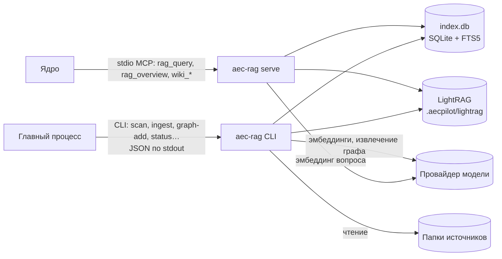

# aec-rag — индекс, поиск с цитатами и вики

## Что делает

`aec-rag` превращает документы проекта в индекс, по которому агент находит ответ и
может сослаться на место в файле: страницу PDF, ячейку таблицы, заголовок. Он же строит
граф знаний по выбранным документам, сверяет дословные выдержки с источником и ведёт
служебную часть вики проекта. Один и тот же пакет Python работает двумя способами:
MCP-сервером для агента и командной строкой для главного процесса.

## Место в архитектуре



Как читать: агент спрашивает индекс через MCP-сервер; строит индекс главный процесс
командой `aec-rag` — индексация идёт минутами и не должна занимать разговор
([решение 0005](../decisions/0005-two-tier-indexing.md)). Оба пути работают с одними и
теми же файлами в папке `.aecpilot/` проекта. К модели `aec-rag` ходит за эмбеддингами
(векторами смысла) и, только для графа, за извлечением сущностей.

## Как устроено внутри

### Два уровня индексации

| Уровень | Что делает | Модель | Когда |
|---|---|---|---|
| 1 — поиск | разбор, нарезка на фрагменты, полнотекстовый индекс и векторы | только эмбеддинги | всегда, для всего подключённого |
| 2 — граф знаний | сущности и связи по фрагментам (LightRAG) | вызов модели на каждый фрагмент | только по выбору человека, папкой или файлом |

Второй уровень стоит денег (замер — `eval/graph-cost-report.md`), поэтому граф по
умолчанию пуст, а перед добавлением `aec-rag graph-preview` показывает, сколько
документов и фрагментов это затронет.

### Путь документа в индекс

1. **Скан** (`indexer.py`, `scan_source`) обходит папку источника и ведёт таблицу
   `files`: размер, время изменения, sha256, состояние. Хеш пересчитывается, только
   если изменились размер или время, но не реже раза в 24 часа. Файлы больше 200 МиБ и
   заблокированные записываются с причиной пропуска. Циклы симлинков отсекаются.
2. **Отбор** (`ingest.py`, `ingest`): работа нужна файлу, у которого sha256 на диске не
   совпадает с sha256, который индекс уже съел (`ingested_files`). Сначала из индекса
   убираются фрагменты исчезнувших файлов:

    ```python title="mcp/aec_rag/src/aec_rag/ingest.py"
    --8<-- "mcp/aec_rag/src/aec_rag/ingest.py:ingest_candidates"
    ```

3. **Разбор** (`parse.py`). PDF — в две скорости: сначала текстовый слой постранично
   (pypdfium2, меньше секунды на 300 страниц), затем в фоне распознаются только страницы
   без пригодного слоя (RapidOCR, модель `eslav`, 300 dpi). DOCX, XLSX и CSV разбирает
   Docling, MD и TXT читаются как текст. У каждого куска — **локатор**: страница, лист и
   диапазон ячеек или заголовок.
4. **Нарезка** (`chunk.py`): фрагмент до 2 000 знаков; локатор не теряется; таблица не
   отрывается от заголовка — большая режется по строкам с повтором шапки.
5. **Запись** (`store.py`, `lightrag_bridge.py`): фрагменты — в `chunks` и полнотекстовый
   `files_fts`, векторы — в хранилище LightRAG под **нашими** идентификаторами фрагментов,
   чтобы от найденного вектора вернуться к локатору точным поиском, а не догадкой. Одна
   транзакция на файл; файл отмечается съеденным только после записи его фрагментов,
   поэтому прерванный прогон продолжается с места остановки.

Ошибка одного файла записывается (`file_errors`, код из закрытого списка `errors.py`), и
прогон идёт дальше. Остановка по просьбе человека проверяется перед каждым файлом и после
каждой распознанной страницы — так хранилище векторов не остаётся записанным наполовину.

### Модель эмбеддингов — часть индекса

Векторы одной модели бессмысленны для другой. Поэтому модель, которой построен индекс,
записана рядом с ним (`.aecpilot/lightrag/aec-index.json`, `rag_index.py`) и
сверяется при каждом открытии; сменить модель — значит перестроить индекс (`--rebuild`).
Там же язык, на котором граф называет сущности. Ключ изоляции LightRAG (`workspace`)
выводится из пути проекта: без него два проекта в одном процессе делили бы реестр
документов, и одноимённый файл второго проекта молча не индексировался бы.

### Поиск

`rag_query` спрашивает оба индекса и сливает их ранжирования:

```python title="mcp/aec_rag/src/aec_rag/server.py"
--8<-- "mcp/aec_rag/src/aec_rag/server.py:rag_query"
```

```python title="mcp/aec_rag/src/aec_rag/server.py"
--8<-- "mcp/aec_rag/src/aec_rag/server.py:rank_fusion"
```

Почему двух: строка таблицы работ с ответом на вопрос «сколько испытаний штампом 600 см²»
лежит во фрагменте вместе с двадцатью другими строками, и по вектору этот фрагмент не
попал даже в первую сотню; полнотекстовый поиск поставил его первым по точным словам
«штампом», «600», «0,5 МПа» (замер 2026-08-15). Слияние — reciprocal rank fusion:
у каждого результата сумма `1 / (60 + место)` по обоим спискам. `score` в ответе — сходство
по вектору; у фрагмента, найденного только полнотекстом, он пустой, а поле `match` говорит,
какой половиной найден фрагмент.

Инструмент отдаёт **материал, а не ответ**: фрагменты с `source_id`, `rel_path` и
локатором. Формулирует ответ и ставит ссылки агент по навыку `aec-qa`; грамматика ссылки
`[src: <источник>/<путь>#<место>]` — в `citation.py` (зеркало в TypeScript —
`citation-pure.ts` окна).

### Проверка выдержек

`rag_check_quote` (и команда `aec-rag check-quotes`) сверяет дословную выдержку с текстом
места, на которое она ссылается. Сопоставление — функция `quote_in_evidence` навыка
`grounded-citations`, который ставится вместе с ядром: `evidence.py` только находит её на
диске и загружает. Окно помечает кнопку цитаты, если выдержки в источнике нет (UR26).

### Инструменты MCP

| Инструмент | Что делает |
|---|---|
| `rag_query` | гибридный поиск фрагментов с локаторами |
| `rag_overview` | материал для обзорного ответа: сущности и связи графа и фрагменты за ними |
| `rag_check_quote` | сверка выдержки с источником |
| `rag_status`, `rag_job` | состояние индекса и задач |
| `rag_ingest` | индексация первого уровня задачей (окно этим путём не пользуется) |
| `rag_graph_scope`, `rag_graph_add` | что входит в граф; добавить папки и файлы (платно) |
| `wiki_init`, `wiki_snapshot`, `wiki_stale`, `wiki_edited`, `wiki_write_page`, `wiki_add_raw`, `wiki_checkpoint`, `wiki_lint` | вики проекта: скелет, снимки источников, устаревшее, правки человека, запись страниц, проверка |

Пишущая задача (индексация или граф) одновременно может быть только одна: место
занимается синхронно, до первого `await` (`claim_mutation`, находка D-49).

### Команды CLI

`aec-rag scan | detach | ingest | status | inventory | export | graph-preview | graph-add |
project-include | project-exclude | index-exclude | index-include | serve | check-quotes |
wiki-init`, у всех — `--project <путь к project.json или папке проекта>`. `ingest` пишет по
строке JSON на каждое событие хода и отчёт последним; строка `stop` в стандартный ввод
останавливает прогон на следующем файле или странице.

## Ключевой код

| Файл | Что там |
|---|---|
| `mcp/aec_rag/src/aec_rag/__main__.py` | команды CLI |
| `mcp/aec_rag/src/aec_rag/server.py` | MCP-сервер, гибридный поиск `search_chunks` |
| `mcp/aec_rag/src/aec_rag/indexer.py` | скан папок, sha256, обнаружение изменений |
| `mcp/aec_rag/src/aec_rag/ingest.py` | индексация первого уровня и распознавание сканов |
| `mcp/aec_rag/src/aec_rag/parse.py`, `chunk.py` | разбор форматов, нарезка с локаторами |
| `mcp/aec_rag/src/aec_rag/db.py`, `store.py` | схема `index.db` и работа с фрагментами |
| `mcp/aec_rag/src/aec_rag/rag_index.py`, `lightrag_bridge.py` | индекс LightRAG проекта, отпечаток модели, наши идентификаторы фрагментов |
| `mcp/aec_rag/src/aec_rag/graph_scope.py`, `graph_export.py` | граф знаний: выбор, оценка, добавление, выгрузка для окна |
| `mcp/aec_rag/src/aec_rag/citation.py`, `evidence.py` | грамматика цитаты, сверка выдержек |
| `mcp/aec_rag/src/aec_rag/wiki.py`, `wiki_lint.py` | вики проекта |
| `mcp/aec_rag/src/aec_rag/project_scope.py`, `index_exclude.py`, `inventory.py` | файлы проекта в индексе, исключения, опись для страницы «Индекс» |

## Данные

`index.db` (SQLite), хранилище LightRAG в `.aecpilot/lightrag/`, выбор графа и исключения
в `project.json`. Схема и диаграмма таблиц — [данные](../data.md).

## Тесты

`mcp/aec_rag/tests/` — 27 файлов pytest: разбор форматов на синтетических PDF, DOCX,
XLSX, нарезка таблиц, инкрементальность, поиск, цитаты, граф с подменённой моделью, вики.
Запуск — `uv run pytest -q mcp/aec_rag`. Качество ответов по документам — эвал `aec-qa`
(`eval/`, AC2) на живой модели, только с согласия владельца.

## Ограничения и известный долг

- Распознавание скана — 2–11 с на страницу; большая папка сканов индексируется часами
  (ход виден в окне, прогон можно остановить и продолжить).
- Смена модели эмбеддингов требует полной перестройки индекса.
- Граф стоит вызова модели на каждый фрагмент.
