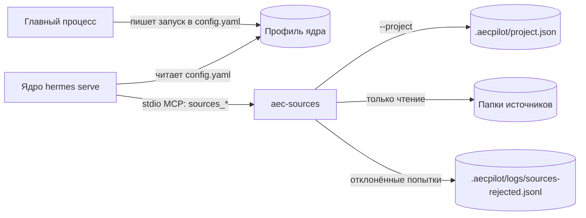

# aec-sources — чтение папок источников

## Что делает

`aec-sources` — MCP-сервер, через который агент видит папки источников проекта:
перечисляет их, обходит дерево, читает файлы и их свойства. Операций записи у него нет —
не запрещены, а не существуют: инструментов записи и удаления в сервере не
зарегистрировано (требование UR2, «источники только на чтение»). Индекс и поиск по
содержимому — у соседнего сервера [aec-rag](aec-rag.md).

## Место в архитектуре



Как читать: сервер запускает само ядро как дочерний процесс по строке из `config.yaml`
профиля; эту строку при открытии проекта пишет главный процесс
(`runtime/register-aec-sources.mjs`). Аргумент `--project` — путь к `project.json`
открытого проекта: из него сервер берёт список источников. Отклонённые попытки сервер
записывает в журнал проекта.

## Как устроено внутри

При запуске (`aec_sources/__main__.py`) сервер читает `project.json`. Если файл
прочитать нельзя, сервер всё равно поднимается и на любой вызов отвечает этой ошибкой:
сервер, вышедший на старте, ядро «паркует» и перезапускает раз в пять минут, а заодно
это мешает соседям (находка D-153).

Инструментов четыре:

| Инструмент | Что делает |
|---|---|
| `sources_list` | список источников и доступна ли каждая папка |
| `sources_tree` | содержимое папки: имя, тип, размер, время изменения |
| `sources_read` | текст файла (UTF-8, битые байты заменяются); целиком — до 10 МиБ, больше — по диапазону `[смещение, длина]` |
| `sources_stat` | размер и время изменения файла или папки |

Каждый путь от модели проходит через `resolve_in_root` (`aec_sources/paths.py`) до
обращения к диску. Отклоняются: абсолютный путь (в том числе UNC), часть пути `..` или
состоящая из одних точек (Windows обрезает точки и пробелы в конце имени, и такие части
неоднозначны), часть с двоеточием (диск вида `C:foo` и альтернативные потоки NTFS).
Затем путь разрешается и ещё раз проверяется, что он остался внутри корня источника.

```python title="mcp/aec_sources/src/aec_sources/server.py"
--8<-- "mcp/aec_sources/src/aec_sources/server.py:sources_read"
```

Журнал отклонённых попыток (`aec_sources/audit.py`) — строки JSON в
`<проект>/.aecpilot/logs/sources-rejected.jsonl`: выход за корень источника
(`path_outside_source`) и вызов несуществующего инструмента (`unknown_tool` — например,
модель пытается угадать `sources_write`). Последний ловит подкласс сервера
`_AuditingMCPServer`. Журнал при 1 МиБ переходит на новый файл, хранится одно прошлое
поколение; сбой записи журнала вызов не ломает.

Когда человек подключает или отключает источник, главный процесс переписывает
`project.json` и просит ядро перезапустить MCP-серверы (`reload.mcp`): уже запущенный
сервер прочитал список источников один раз и иначе продолжал бы отдавать старый.

## Ключевой код

| Файл | Что там |
|---|---|
| `mcp/aec_sources/src/aec_sources/server.py` | четыре инструмента и журналирующий сервер |
| `mcp/aec_sources/src/aec_sources/paths.py` | `resolve_in_root` — защита от выхода за корень |
| `mcp/aec_sources/src/aec_sources/fs.py` | листинг, чтение по диапазону, свойства |
| `mcp/aec_sources/src/aec_sources/config.py` | чтение источников из `project.json` |
| `mcp/aec_sources/src/aec_sources/audit.py` | журнал отклонённых попыток |
| `runtime/register-aec-sources.mjs` | запись запуска сервера в `config.yaml` профиля |

## Данные

Читает `project.json` и файлы источников; пишет только журнал
`.aecpilot/logs/sources-rejected.jsonl`. Подробно — [данные](../data.md).

## Тесты

`mcp/aec_sources/tests/` (pytest): инструменты, защита путей и пограничные случаи
(`test_edge_fixtures.py`), отсутствие записи (`test_ro_negative.py`), сервер без
`project.json` (`test_missing_project.py`), сквозной вызов по протоколу MCP
(`mcp_harness.py`, `test_smoke.py`). Запуск — `uv run pytest -q mcp/aec_sources`.

## Ограничения и известный долг

- `sources_read` отдаёт текст; PDF, DOCX и таблицы агент читает через поиск
  [aec-rag](aec-rag.md), который их разбирает.
- `sources_stat` не считает sha256 — хеши ведёт сканер `aec-rag`.
