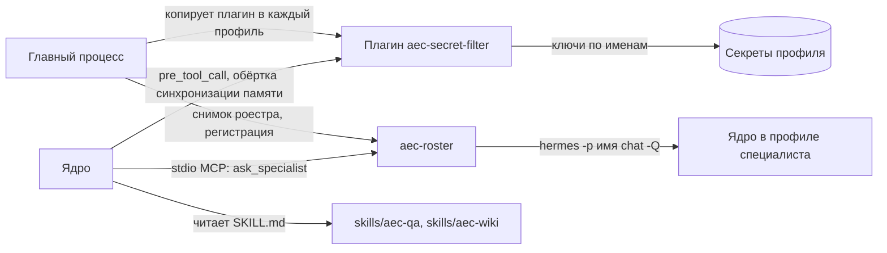

# Расширения ядра: специалисты, фильтр секретов, навыки

## Что делает

Ядро мы не правим, поэтому всё своё поведение агента продукт добавляет штатными точками
расширения ядра:

- **`aec-roster`** — MCP-сервер с одним инструментом «спросить специалиста по имени»
  (`@имя` в любом чате);
- **плагин `aec-secret-filter`** — не даёт секрету уйти в память агента, отдаёт ключи
  провайдеров каждому профилю, защищает поставляемые навыки и обслуживает страницу
  «Память»;
- **навыки `aec-qa` и `aec-wiki`** — инструкции агенту: как отвечать по документам со
  ссылками и как вести вики проекта.

## Место в архитектуре



Как читать: плагин живёт внутри процесса ядра и вызывается его хуками; `aec-roster` —
дочерний процесс ядра, который для ответа запускает ядро ещё раз в профиле нужного
специалиста; навыки ядро читает как файлы. Главный процесс ставит плагин во все профили
до старта ядра и ведёт снимок списка специалистов для `aec-roster`.

## Как устроено внутри

### Специалисты: `aec-roster`

Специалист — профиль ядра с именем, ролью, моделью и памятью
([решение 0007](../decisions/0007-roster-donor-plugin.md)). Интерфейс роестра — перенесённый
плагин донора; наш сервер добавляет одно действие, чтобы ответ специалиста появился в
той же переписке, где его спросили: вставить реплику в сессию снаружи у ядра нечем, значит
спрашивать должен сам агент.

```python title="mcp/aec_roster/src/aec_roster/server.py"
--8<-- "mcp/aec_roster/src/aec_roster/server.py:ask_specialist"
```

`resolve` находит специалиста в снимке роестра, который главный процесс обновляет по
опросу ядра (`runtime/register-aec-roster.mjs`, `writeRosterSnapshot`); если имени нет,
список специалистов приходит в тексте ошибки. `ask` (`runner.py`) запускает
`hermes -p <имя> chat -Q` в постоянном чате специалиста; разбор вывода (`ask.py`) отделяет
ответ от размышлений модели. `busy` не даёт спросить одного специалиста дважды
одновременно. Ответ возвращается с подписью автора.

### Фильтр секретов

У записи в память два пути, и плагин закрывает оба (`plugins/aec_secret_filter/__init__.py`):

1. **Запись инструментом** (`memory`, `mem0_add`, `mem0_update`) — хук `pre_tool_call`
   отказывает, если в тексте виден секрет; агент видит отказ и перескажет факт без
   значения. Хук ядра при зависании закрывается отказом, а не пропуском.
2. **Автоматическая запись хода** в Mem0 после каждого хода — вызова инструмента там нет,
   поэтому плагин оборачивает метод синхронизации памяти ядра и **вырезает** значение,
   заменяя его на `<секрет удалён>`: отказывать некому, а выбросить ход целиком значило бы
   потерять обычные факты рядом.

Что считается секретом, решает набор шаблонов в `secrets.py` — от ключей известных
провайдеров и закрытых ключей до «пароль — Qwerty12345!» в обычной фразе:

```python title="plugins/aec_secret_filter/secrets.py"
--8<-- "plugins/aec_secret_filter/secrets.py:find_secrets"
```

Остальные обязанности плагина:

- `key_source.py` — источник секретов по контракту ядра: каждый профиль получает ключи
  провайдеров, имена которых главный процесс перечислил в `AEC_PROVIDER_KEY_NAMES`. Без
  этого при нескольких профилях (специалистах) `aec-rag` и Mem0 оставались без ключа.
- `shipped_skills.py` — правка агентом поставляемого навыка уходит в копию в профиле, а не
  в папку программы; удалить поставляемый навык нельзя.
- `memory_facts.py` — команда `/aec-memory-facts list | delete <id>` для страницы «Память»:
  список фактов Mem0 и удаление без остановки ядра.
- Команда `aec-filter-status` — главный процесс спрашивает её перед первым ходом каждой
  сессии и отказывает в ходе, если плагин не загружен.
- Инструменты сейфа паролей браузера (`browser_vault…`) отклоняются: вход на сайт
  выполняет человек.

`plugin.yaml` явно объявляет `kind: standalone`: без этого ядро угадывает вид плагина по
первым 8 КБ `__init__.py` и, встретив там имя класса провайдера памяти, не грузит модуль.

### Навыки

`skills/aec-qa/SKILL.md` — ответ только по найденному в документах, каждое утверждение со
ссылкой `[src: <источник>/<путь>#<место>](#cite)`, проверка дословных выдержек до ответа,
какой инструмент `aec-rag` для какого вопроса. `skills/aec-wiki/SKILL.md` — ведение вики
проекта (адаптация навыка `llm-wiki` ядра). Ядро читает их из папки программы
(`skills.external_dirs` профиля). Изменения навыков проверяются прогоном
(`eval/`), а не тестами на наличие строк.

## Ключевой код

| Файл | Что там |
|---|---|
| `mcp/aec_roster/src/aec_roster/server.py` | инструмент `ask_specialist` |
| `mcp/aec_roster/src/aec_roster/roster.py`, `runner.py`, `ask.py` | снимок роестра, запуск специалиста, разбор ответа |
| `plugins/aec_secret_filter/__init__.py` | регистрация хуков и команд, отказ и вырезание |
| `plugins/aec_secret_filter/secrets.py` | шаблоны секретов |
| `plugins/aec_secret_filter/key_source.py`, `mem0_shared.py`, `mem0_turns.py` | ключи профилям, общий клиент Mem0 |
| `plugins/aec_secret_filter/shipped_skills.py`, `memory_facts.py` | поставляемые навыки, факты памяти |
| `skills/aec-qa/SKILL.md`, `skills/aec-wiki/SKILL.md` | навыки агента |
| `runtime/register-secret-filter.mjs`, `register-aec-roster.mjs` | установка плагина и сервера в профили |

## Данные

Плагин хранит переключатель автозаписи памяти `aec-memory.json` в профиле и файл
`shipped-skills.json` рядом с собой; роестр — снимок специалистов, который пишет главный
процесс. Факты Mem0 лежат в хранилище профиля. Подробно — [данные](../data.md).

## Тесты

`plugins/aec_secret_filter/tests/` (6 файлов pytest): шаблоны секретов, отказ и вырезание,
источник ключей, общий клиент Mem0, поставляемые навыки, факты памяти.
`mcp/aec_roster/tests/` (4 файла): разбор вывода, поиск по имени, занятость, сервер по
протоколу MCP. Поведение навыков — эвалы `eval/` на живой модели (AC2).

## Ограничения и известный долг

- Шаблон «слово-ключ рядом со значением» срабатывает и на номера вида «AEC-1024567»:
  цена ложного срабатывания — переписанная фраза, цена пропуска — секрет в памяти навсегда.
- Ответ специалиста занимает минуты: это полный ход ядра в его профиле.
