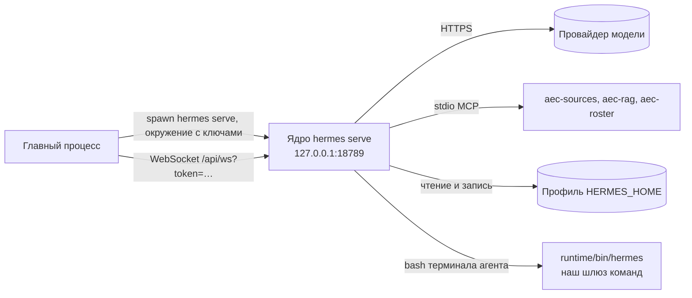

# Ядро и его запуск

## Что делает

Ядро — агент hermes-agent (Nous Research, MIT): разговор с моделью, вызовы
инструментов, сессии, память, навыки, расписания, внешние каналы. Мы его не форкаем и не
правим ([решение 0001](../decisions/0001-core-without-fork.md)): ставим ровно известный
коммит из git и запускаем отдельным процессом `hermes serve` — шлюзом, к которому
подключается главный процесс. Наша часть — каталог `runtime/`: установка ядра на пине,
его запуск, профиль и инструменты подъёма пина.

## Место в архитектуре



Как читать: главный процесс запускает ядро и подключается к нему; всё остальное ядро
делает само — ходит к модели, запускает MCP-серверы как дочерние процессы, читает и пишет
свой профиль. Команда `hermes` в терминале агента попадает в наш шлюз команд, а не в
настоящий CLI ядра.

## Как устроено внутри

### Пин и два варианта раскладки

Версия и коммит ядра записаны в одном месте:

```js title="runtime/hermes-env.mjs"
--8<-- "runtime/hermes-env.mjs:core_pin"
```

Пин ставится на коммит, а не на тег: тег можно передвинуть, коммит — нет. Автор перестал
публиковать колёса на PyPI, а его сборщик отказывается собирать колесо, поэтому
`runtime/hermes-env.mjs` описывает две раскладки:

| | Разработка (рабочая копия) | Установленная программа |
|---|---|---|
| Исходники ядра | `runtime/.hermes-src` — неглубокий клон на `HERMES_SHA`, не редактируется | `runtime/core/` — снимок того же коммита в payload |
| Python ядра | `runtime/.hermes-venv` (CPython 3.14.6, установка `-e` из `.hermes-src`) | интерпретатор payload, собранного их менеджером пакетов (PM) |
| Признак | есть `.git` в корне | есть `runtime/core/manifest.json` или `install-mode.txt` |
| Профиль | `runtime/dev-profile` | `<root>/data/profile` |

`node runtime/setup.mjs` готовит разработку за 8 шагов: venv, исходники на пине,
ограничения версий из `uv.lock` ядра, установка `hermes-agent[mcp,ddgs]` и зависимостей
плагина Mem0, профиль разработки, затем сборка обоих payload поставки (`runtime/core`,
`runtime/mcp`) и сверка их хешей с записью `runtime/payload/payload-versions.json`. Так
рабочая копия работает ровно на том, что получит инженер. Сборка payload описана на
странице [установка и поставка](packaging.md).

### Профиль

Профиль ядра (`HERMES_HOME`) — каталог с конфигом, сессиями, памятью, навыками и
плагинами одного агента. Где он лежит, решает одна константа:

```js title="runtime/hermes-env.mjs"
--8<-- "runtime/hermes-env.mjs:profile_dir"
```

`AEC_HERMES_HOME` направляет весь стек — главный процесс и `serve.mjs` — на другой
профиль: так автотесты работают на временной копии `runtime/e2e-profile`, не задевая
профиль ручной приёмки. Профиль никогда не лежит в домашнем каталоге человека и не
пересекается с обычной установкой Hermes на той же машине.

### Запуск `hermes serve`

`startServe` в `runtime/serve.mjs` перед запуском кладёт в профиль наш `SOUL.md` (если
своего там нет) и предупреждает, если наборы инструментов урезаны. Затем:

```js title="runtime/serve.mjs"
--8<-- "runtime/serve.mjs:spawn_serve"
```

- `--isolated` — без него второй `serve` на том же профиле «присоединился» бы к живому
  процессу-сироте и вышел, не открыв порта.
- `HERMES_DASHBOARD_SESSION_TOKEN` — токен шлюза задаём сами (24 случайных байта или
  постоянный токен серверной установки); он входит в адрес WebSocket и не покидает
  главный процесс.
- `HERMES_TUI_CHECKPOINTS=1` — снимки файлов перед правкой агентом (откат, UR14): путь
  шлюза читает этот переключатель из окружения, а не из конфига.
- `memoryEnv` — выключенная телеметрия Mem0 и каталог Mem0 внутри профиля.
- `extraEnv` — расшифрованные ключи провайдеров и настройки индекса; на диск они не
  пишутся.

Порт — 18789 (`AEC_SERVE_PORT` меняет его для приёмочного стенда), адрес — только
127.0.0.1. `waitHealthy` ждёт первого кадра шлюза (`gateway.ready`): холодный старт ядра
замерен в 29 с, поэтому окно ожидания — 2 минуты. Вывод процесса пишется в
`<профиль>/serve.log`. `stopServe` даёт ядру 5 с на мягкую остановку.

### Что продукт держит в профиле сам

Главный процесс перед каждым запуском дописывает в `config.yaml` профиля свои
умолчания (правила — `apps/desktop/src/main/agent-defaults-pure.ts`): выключенный голос,
бюджеты хода, отказ от самопроверки обновлений и телеметрии ядра, веб-поиск DuckDuckGo
без ключа, режим подтверждений команд, выключенные наборы инструментов, регистрацию наших
MCP-серверов и плагинов. Большинство правил дописывает умолчание, не трогая уже
выбранного человеком (`applyConfigDefault` в `apps/desktop/src/main/index.ts`).

### Память Mem0

С версии 0.22 провайдер Mem0 — внешний плагин. `setup.mjs` держит его исходники на
`MEM0_PLUGIN_SHA` (версия 1.3.0) в `runtime/.mem0-plugin-src`, а главный процесс при
старте копирует плагин в `plugins/mem0` каждого профиля
(`runtime/register-mem0-plugin.mjs`). Хранилище — локальный qdrant внутри профиля
([решение 0006](../decisions/0006-memory-mem0.md)).

### Шлюз команд `hermes`

Расписания специалистов донора запускают `hermes -p <специалист> chat …`, поэтому
`hermes` должен быть на PATH процессов ядра. Но та же команда меняет настройки ядра —
агент однажды поставил MCP-сервер в обход карточки согласия. Поэтому первым на PATH
стоит `runtime/bin/hermes` → `hermes_gate.py`: пропускает только `chat` (с `-p`),
`--version` и `--help`, остальное отклоняет понятным агенту сообщением.

### Подъём пина

Ядро выходит раз в 1–2 месяца. Подъём — это измерение, а не правка по памяти:

- `runtime/contract-snapshot.mjs` записывает поверхность ядра (методы шлюза, маршруты
  REST, умолчания конфига) и то, чем из неё пользуется наш код, в
  `runtime/contracts/hermes-<версия>.json`; `contract-diff.mjs` сравнивает две версии;
- `runtime/donor-report.mjs <старый SHA> <новый SHA>` показывает, какие перенесённые
  файлы донора изменились (сначала — файлы с нашими правками);
- разбор каждого подъёма лежит в `runtime/contracts/reading-<версия>.md` и
  `donor-move-<версия>.md`.

Порядок и проверки после подъёма — [эксплуатация](../operations.md), раздел «Подъём пина ядра»;
факты о ядре, проверенные по коду, — [core-facts](../core-facts.md).

## Ключевой код

| Файл | Что там |
|---|---|
| `runtime/hermes-env.mjs` | пин, пути обеих раскладок, профиль, команда запуска MCP-серверов |
| `runtime/setup.mjs` | установка ядра на пине и сборка payload |
| `runtime/serve.mjs` | запуск, проверка готовности и остановка `hermes serve`; `node runtime/serve.mjs smoke` |
| `runtime/default-soul.mjs` | наш `SOUL.md` по умолчанию (помощник инженера-конструктора) |
| `runtime/memory-config.mjs`, `register-mem0-plugin.mjs` | память Mem0 |
| `runtime/register-aec-*.mjs`, `register-secret-filter.mjs` | регистрация наших MCP-серверов и плагина в профиле |
| `runtime/bin/hermes`, `hermes_gate.py` | шлюз команд `hermes` для терминала агента |
| `runtime/contract-snapshot.mjs`, `contract-diff.mjs`, `donor-report.mjs` | инструменты подъёма пина |
| `runtime/*-probe.mjs` | живые зонды поведения ядра (запускаются вручную, по одному) |

## Данные

Профиль ядра: `config.yaml`, `SOUL.md`, база сессий `state.db`, память (записка ядра и
хранилище Mem0), навыки, плагины, журналы, `serve.log`. Подробно — [данные](../data.md).

## Тесты

23 теста `runtime/*.test.mjs` (Vitest) проверяют наши модули: регистрацию серверов,
SOUL, шлюз команд, разбор контрактов. Поведение самого ядра проверяется живыми зондами
`runtime/*-probe.mjs` и живой приёмкой — они запускают настоящее ядро с моделью и стоят
денег, поэтому идут только с согласия владельца.

## Ограничения и известный долг

- T49: подпись A2A не работает из-за дефекта ядра (`eval/reports/a2a-signature-defect.md`)
  — ждёт исправления у авторов.
- `pnpm parity` (реестры паритета, инструментов и платформ) сверяет таблицы кода с
  исключениями HX в [PRODUCT](../PRODUCT.md) и с задачами из [TASKS](../TASKS.md) и
  завершённых этапов `docs/history/stage-*.md`; задачу он понимает и строкой таблицы
  этапа, и пунктом `- [x] T44` журнала. Код: `runtime/parity-registry.mjs`,
  `readTasksText`.
- Зонды без `AEC_HERMES_HOME` пишут в `runtime/dev-profile` — профиль ручной приёмки.
