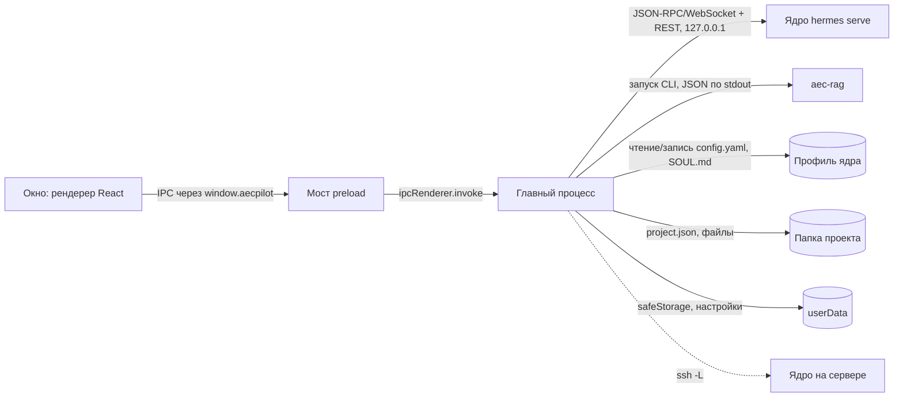

# Главный процесс и мост preload

## Что делает

Главный процесс (main) — сердцевина приложения на Electron. Он запускает ядро
hermes-agent и держит с ним единственное соединение, проверяет каждый вызов, пришедший
из окна, открывает проект и регистрирует для ядра наши MCP-серверы, запускает
сканирование и индексацию, хранит ключи провайдеров в шифрованном хранилище ОС и в
режиме сервера живёт значком в трее. Окно (рендерер) само ни с чем внешним не говорит —
всё идёт через main (ограничение C9 в [PRODUCT](../PRODUCT.md)).

## Место в архитектуре



Как читать: сплошные стрелки — вызовы, которые инициирует главный процесс, пунктир —
вариант подключения к ядру на другой машине. Окно знает только API `window.aecpilot`;
адрес, порт и токен шлюза ядра остаются в main. К ядру main ходит по двум каналам одного
процесса: поток JSON-RPC по WebSocket (разговор, события) и REST (файлы, настройки).
Индексацию main запускает напрямую командной строкой `aec-rag`, не через агента: она
идёт минутами и не должна занимать разговор.

## Как устроено внутри

### Запуск приложения

Порядок шагов в `app.whenReady()` (`apps/desktop/src/main/index.ts`) важен, потому что
ядро читает свой конфиг один раз при старте:

1. Журнал приложения `desktop.log` (`app-log.ts`) — первым делом, чтобы старт попал в
   журнал.
2. Выбор подключения (`connection.ts`): своё ядро, ядро по адресу или по SSH.
3. Подготовка профиля ядра: файл `config.yaml`, доверенные навыки проекта.
4. Восстановление последнего проекта (`restore-project.ts`) — **до** подъёма ядра, чтобы
   регистрация MCP-серверов проекта уже лежала в конфиге, когда ядро его прочтёт.
5. Настройки профиля, которые продукт держит сам: модель, выключенный голос, бюджеты
   хода, отказ от телеметрии и самообновления ядра, веб-поиск, режим подтверждений,
   выключенные наборы инструментов (функции `apply…` в `index.ts`, правила — в
   `agent-defaults-pure.ts`). Затем плагин фильтра секретов во все профили
   (`armProfiles`).
6. Запуск `hermes serve` (`runtime/serve.mjs`, функция `startServe`), ожидание до
   4 минут первого кадра шлюза (`waitHealthy`) и подключение клиента (`connectGateway`).
7. Планировщик расписаний ядра, если человек его включил (`cron-runner.ts`,
   [решение 0011](../decisions/0011-schedule-tick-in-main.md)).
8. Окно, трей, быстрый ввод по горячей клавише, сторож сна и пробуждения. В режиме
   сервера вместо окна — значок в трее (`server-tray.ts`) и слежение за проектом
   сервера, см. [сценарий «сервер и клиент»](../flows/server-client.md).

Сбой ядра на старте окно не роняет: оно открывается и показывает состояние связи.

### Мост preload и проход к шлюзу

Мост `apps/desktop/src/preload/index.ts` публикует в окне один объект
`window.aecpilot` (тип `AecpilotApi` в `apps/desktop/src/shared/ipc.ts`). Код донора
(Hermes Desktop) — это около двухсот типизированных обёрток над одним вызовом
`request(method, params)` и такой же дверью REST. Поэтому вместо отдельного канала IPC
на каждую операцию у моста есть два общих прохода — `gateway:rpc` и `gateway:rest`:

```ts title="apps/desktop/src/preload/index.ts"
--8<-- "apps/desktop/src/preload/index.ts:gateway_api"
```

На стороне main каждый вызов проходит проверки до того, как уйдёт в ядро:

```ts title="apps/desktop/src/main/index.ts"
--8<-- "apps/desktop/src/main/index.ts:gateway_rpc"
```

По шагам: `checkRpcCall` отбрасывает имя метода неверной формы и запрещённые методы;
`sanitizeRpcParams` снимает признак скрытого хода (у продукта нет невидимых ходов,
UR28/AC13); `applySoulLanguage` дописывает язык ответов в SOUL нового специалиста;
`applyProjectCwd` ставит новой сессии рабочую папку открытого проекта;
`ensureSecretFilter` перед первым ходом сессии убеждается, что плагин фильтра секретов
загружен в ядро, и иначе отказывает в ходе. Ошибка возвращается значением
`{ ok: false, error }`, а не исключением: `ipcRenderer.invoke` донёс бы только текст, а
код и данные JSON-RPC нужны коду донора.

Правила прохода собраны в чистом модуле без Electron — его тестируют без шлюза:

```ts title="apps/desktop/src/main/gateway-passthrough-pure.ts"
--8<-- "apps/desktop/src/main/gateway-passthrough-pure.ts:denied_methods"

--8<-- "apps/desktop/src/main/gateway-passthrough-pure.ts:check_rpc_call"
```

`model.save_key` записал бы ключ провайдера в конфиг ядра открытым текстом, а
`POST /api/env/reveal` вернул бы сохранённые секреты; у продукта ключи живут в
safeStorage ([решение 0014](../decisions/0014-credentials-storage.md)), поэтому у этих
путей нет законного вызывающего. Запись `PUT /api/env` из панели настроек донора
перехватывается (`classifyEnvWrite`): всё, кроме явно несекретных имён (`…_URL`,
`…_HOST`, `…_MODEL` и т. п.), уходит в шифрованное хранилище, а не в `.env` профиля.

### События ядра

Клиент шлюза (`apps/desktop/src/shared/gateway/client.ts`, класс `GatewayClient`) держит
WebSocket, переподключается с паузой от 0,5 до 8 с и отдаёт три потока: события,
вопросы ядра окну (подтверждение команды, секрет, согласие) и смену состояния. Main
рассылает **все** события во **все** окна каналом `chat:event` — маршрутизацию по
сессиям делает код донора. После обрыва связи main догоняет пропущенные кадры
(`catchUpAfterReconnect`, отметка в `event-replay-pure.ts`): иначе ответ, оборванный
посреди хода, пришёл бы пустым.

### Проект

Открытие проекта — одна функция для кнопки «Открыть» и для восстановления при старте:

```ts title="apps/desktop/src/main/index.ts"
--8<-- "apps/desktop/src/main/index.ts:activate_project"
```

`applyProjectSkills` оставляет в конфиге ядра каталоги навыков ровно этого проекта (и
только если человек им доверяет); `startScanSchedulerForProject` перезапускает
расписание сканирования с интервалом из `project.json` (по умолчанию 300 с);
`registerAecSourcesForProject` пишет в `config.yaml` профиля запуск `aec-sources` и
`aec-rag` с путём к `project.json` этого проекта, включает память Mem0 с проектной
областью и, если конфиг изменился, просит ядро перезапустить MCP-серверы
(`reload.mcp`) — ядро держит запущенный сервер, пока его не попросят. Активная сессия
чата сбрасывается: следующая создастся в папке нового проекта.

Открыть можно только папку, выбранную в системном диалоге или уже стоящую в списке
недавних (находка D-47): путь из окна сам по себе не доверенный.

### Индексация и сканирование

Main запускает команду `aec-rag` (`aec-rag-command.ts`: в разработке —
`.venv/Scripts/aec-rag.exe`, в установке — `python -s -m aec_rag` поставленного
Python). `scan-runner.ts` запускает `aec-rag scan`, `ingest-runner.ts` — `aec-rag ingest`
и читает его поток строк JSON. Одновременно идёт не больше одной индексации на процесс.
Подробно — [сценарий индексации](../flows/indexing.md).

### Ключи провайдеров

Ключ, введённый в интерфейсе, шифруется safeStorage (на Windows — DPAPI учётной
записи) и хранится в `llm-settings.json` в `userData`:

```ts title="apps/desktop/src/main/llm-settings.ts"
--8<-- "apps/desktop/src/main/llm-settings.ts:set_provider_key"
```

В ядро ключ попадает только через окружение дочернего процесса (`buildExtraEnv`), поэтому
действует со следующего запуска ядра — `keys:save` перезапускает его сразу. Окно узнаёт о
ключе три вещи: сохранён ли он, перекрывает ли его `.env` профиля и доступно ли
шифрование; ни значения, ни маски значения через IPC не проходит.

### Роли установки

`install-mode.ts` читает слово из `<root>/install-mode.txt`: `full` (всё на этой машине),
`server` (ядро без окна, значок в трее, запуск при входе в систему) или `client` (только
окно, своего ядра нет). В рабочей копии файла нет — роль `full`.

## Ключевой код

| Файл | Что там |
|---|---|
| `apps/desktop/src/main/index.ts` | запуск приложения, обработчики IPC (181 `ipcMain.handle`), проход к шлюзу, проект, индексация, роль сервера |
| `apps/desktop/src/main/gateway-passthrough-pure.ts` | правила прохода: запреты, чистка параметров, перехват `/api/env`, пометка недоверенного текста страницы |
| `apps/desktop/src/preload/index.ts` | API окна `window.aecpilot` |
| `apps/desktop/src/shared/ipc.ts` | типы каналов IPC и API окна |
| `apps/desktop/src/shared/gateway/client.ts` | клиент JSON-RPC по WebSocket с переподключением |
| `apps/desktop/src/main/project-manager.ts` | создание, открытие и источники проекта, `project.json` |
| `apps/desktop/src/project/` | генератор папки проекта, проверка `project.json` и источников |
| `apps/desktop/src/main/scan-scheduler.ts`, `scan-runner.ts`, `ingest-runner.ts`, `graph-runner.ts` | расписание сканирования и запуск `aec-rag` |
| `apps/desktop/src/main/llm-settings.ts` | модель, адрес и ключи провайдеров в safeStorage |
| `apps/desktop/src/main/connection.ts`, `ssh.ts`, `remote-project-pure.ts` | подключение к ядру по адресу и по SSH, проект на сервере |
| `apps/desktop/src/main/server-tray.ts`, `server-token.ts`, `server-keys-window.ts` | роль сервера: трей, постоянный токен, окно ключей |
| `apps/desktop/src/main/cron-runner.ts` | процесс расписаний ядра |
| `apps/desktop/src/main/data-root-pure.ts` | раскладка `<root>/data` установленной программы |

Правило модулей: решение без побочных действий живёт в файле `*-pure.ts` и тестируется
без Electron; файл без суффикса только исполняет его.

## Данные

Main пишет `userData` (настройки окна, ключи, недавние проекты, доверие к навыкам),
`config.yaml` и `SOUL.md` профиля ядра, `.aecpilot/project.json` проекта и
`server-state.json` в режиме сервера. Список файлов и их назначение — [данные](../data.md).

## Тесты

87 файлов `apps/desktop/src/main/*.test.ts` (Vitest, среда node): чистые модули — без
Electron, исполняющие — с подменой зависимостей. Сквозные проверки по живому окну —
Playwright (`apps/desktop/e2e/`): smoke и приёмка на mock-шлюзе
(`apps/desktop/e2e/mock_gateway.py`), живая приёмка на настоящем ядре. Команды — в
[эксплуатации](../operations.md).

## Ограничения и известный долг

- `index.ts` — около 6 900 строк: большинство обработчиков IPC собрано в одном файле.
- Смена модели или ключа перезапускает ядро; холодный старт ядра — до 30 с, поэтому
  окно ожидания — 2 минуты (`HEALTH_TIMEOUT_MS`), на первом запуске после установки — 4.
