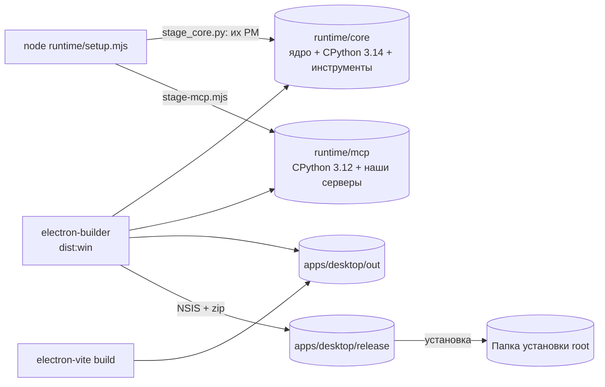

# Установка и поставка

## Что делает

Поставка собирает из рабочей копии установщик Windows и переносной zip, в которых есть
всё для работы без интернета, кроме модели: приложение Electron, ядро со своим Python и
инструментами, наш Python 3.12 для MCP-серверов, навыки и плагин. Установщик ставит всё в
одну выбранную человеком папку `<root>` и предлагает три режима: «всё на этой машине»,
«только сервер», «только приложение»
([решения 0009](../decisions/0009-single-install-directory.md) и
[0010](../decisions/0010-packaging-nsis-payload.md)).

## Место в архитектуре



Как читать: два payload готовит `setup.mjs`, интерфейс собирает `electron-vite`, а
`electron-builder` складывает всё в установщик NSIS и zip. На машине инженера всё
оказывается под одной папкой `<root>`.

## Как устроено внутри

### Два payload Python

**Ядро** (`runtime/payload/stage_core.py`) собирается так, как авторы собирают свой
настольный пакет: их менеджер пакетов (PM) ставит закреплённый CPython, переносимое дерево
зависимостей и закреплённые инструменты, их сборщик пишет запускатели и `manifest.json`.
Мы зовём их сборщик по частям, а не `hermes pm bundle`, ради двух отличий: берём только
нужные продукту инструменты (агентный браузер с Chromium, Git for Windows для bash
терминала агента и снимков, Node и npm, ripgrep, uv) и только те дополнения ядра, которые
ставит разработка. Исключены: сейф паролей, управление компьютером, голос, `gh`, локальные
модели и `ffmpeg` (его сборка под GPL); пакет `pillow-heif` удаляется (колесо под GPLv2).
Снимок кода ядра — `git archive` закреплённого коммита, без правок.

**Наши MCP-серверы** (`runtime/payload/stage-mcp.mjs`) — автономный CPython 3.12
(python-build-standalone) со всеми зависимостями в его собственном `site-packages`:
переносимая папка без абсолютных путей сборочной машины. Версии — из нашего `uv.lock`
(`uv export --frozen` с хешами), то есть те же, на которых идут тесты. Модели RapidOCR
скачиваются при сборке, поэтому распознавание сканов в установленной программе не
требует сети. Серверы запускаются как `python -s -m aec_rag` и т. п.

`runtime/payload/payload-versions.json` записывает версии обоих payload; `setup.mjs`
сверяет с ним хеши после сборки.

### Что попадает в установщик

```js title="apps/desktop/electron-builder.config.cjs"
--8<-- "apps/desktop/electron-builder.config.cjs:extra_files"
```

`runtime/` кладётся **рядом** с `AECPilot.exe` (`extraFiles`, а не ресурсами), поэтому
главный процесс и `runtime/hermes-env.mjs` находят его одинаково в рабочей копии и в
установке. Из `runtime/` берутся только модули `.mjs`, шлюз команд, шаблоны, демо-данные и
оба payload; зонды, тесты и профили остаются за бортом (`RUNTIME_FILTER`). Из
`node_modules` в `app.asar` идут только два пакета, которые главный процесс грузит во время
работы (`exceljs`, `get-windows`), — остальное уже внутри сборки окна.

```js title="apps/desktop/electron-builder.config.cjs"
--8<-- "apps/desktop/electron-builder.config.cjs:windows_targets"
```

Переносимая сборка — zip того же дерева: цель `portable` у electron-builder распаковывала
бы ~3 ГБ во временную папку при каждом запуске. Подписи кода на MVP нет (допущение A7).
После упаковки (`afterPack`) пишутся `THIRD-PARTY-NOTICES.txt` и список установленных
файлов для удаления (`installed-entries.cjs`).

### Установщик

`apps/desktop/build/installer.nsh` дополняет шаблон NSIS:

- **Режим** записывается одним словом в `<root>/install-mode.txt`. «Только приложение»
  удаляет `runtime/core` и `runtime/mcp` сразу после распаковки (архив один, пропустить
  их нельзя). «Только сервер» заводит задачу Windows при входе пользователя:
  `AECPilot.exe --server` без окна, со значком в трее; задача по триггеру входа из XML не
  требует прав администратора. Тихая установка принимает `/MODE=full|server|client`;
  обновление сохраняет прежний режим.
- **Никаких копий вне папки установки**: копия установщика, которую шаблон кладёт в
  `%LOCALAPPDATA%` для дифференциальных обновлений, удаляется — автообновления у
  продукта нет.
- **Удаление** снимает только то, что поставил установщик. Две галочки, по умолчанию
  выключенные: «Удалить и мои данные» (`<root>/data`) и «Удалить индексы проектов» (папки
  `.aecpilot` проектов из `data/index-locations.txt`). Документы и папки проектов не
  удаляются никогда; тихое удаление сохраняет и данные, и индексы.

### Всё под одной папкой

В установленной программе всё, что пишет продукт, лежит под `<root>/data`: профиль ядра
(`data/profile`), `userData` Electron, кэши, временные файлы, npm агента
(`apps/desktop/src/main/data-root-pure.ts`). Раскладка — [данные](../data.md).

### Обновления

Новая версия только объявляется: при запуске приложение читает публичный файл последней
версии и показывает уведомление с кнопкой «Скачать» (`update-check.ts`). Адрес файла —
`aecpilot.updateFeedUrl` в `apps/desktop/package.json`; пустой адрес выключает проверку и
сетевой запрос. С 2026-10-26 (решение владельца, PRODUCT A8) адрес —
`https://github.com/EvgenVer/AECPilot/releases/latest/download/latest.json`: GitHub
перенаправляет его на файл `latest.json` самого нового релиза. Пока релизов нет, ответ —
404, и уведомления нет. Как выпустить версию — [эксплуатация](../operations.md)
§«Выпуск версии».

## Ключевой код

| Файл | Что там |
|---|---|
| `runtime/setup.mjs` | установка ядра и сборка обоих payload |
| `runtime/payload/stage_core.py`, `settle_core.py` | payload ядра их PM, отбор инструментов |
| `runtime/payload/stage-mcp.mjs` | payload наших MCP-серверов |
| `runtime/payload/payload-versions.json`, `payload-hashes.mjs` | запись версий и хешей |
| `apps/desktop/electron-builder.config.cjs` | состав установщика и zip |
| `apps/desktop/build/installer.nsh`, `installed-entries.nsh` | режимы, задача сервера, страница удаления |
| `apps/desktop/installed-entries.cjs`, `third-party-notices.cjs` | список файлов для удаления, лицензии сторонних компонентов |
| `apps/desktop/src/main/install-mode.ts`, `data-root-pure.ts` | режим установки и папка `data` в работающей программе |
| `LICENSE.txt` | лицензия продукта ([решение 0015](../decisions/0015-licensing.md)) |

## Данные

Установщик пишет `<root>/install-mode.txt`; программа — всё под `<root>/data`.

## Тесты

`apps/desktop/src/main/installed-entries.test.ts` — список файлов для удаления;
`data-root-pure.test.ts`, `install-mode-pure.test.ts` — раскладка установленной программы.
Проверка «чистой машины» (проект `clean-machine` в `apps/desktop/playwright.config.ts`)
запускает установленную программу и идёт только под `D:\AECPilot-cleantest`.

## Ограничения и известный долг

- Сборка установщика — 30–60 минут (0.1.0: 45 минут); установка начисто — от 9 минут
  (517 с, замер T43.1) до 30 минут (1778 с, 0.1.0 на 2026-10-27, тот же диск под
  нагрузкой) — время зависит от диска и антивирусной проверки ~60 000 файлов.
- Установщик не подписан: Windows SmartScreen предупреждает при запуске.
- Только Windows x64; macOS и Linux — в разделе Later [TASKS](../TASKS.md).
