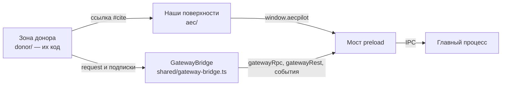

# Окно приложения (рендерер)

## Что делает

Окно рисует весь интерфейс: чат с агентом, сессии, настройки, специалистов, предпросмотр,
доску задач — и наши поверхности для инженера: проводник проекта и источников,
просмотрщики документов, цитаты-кнопки, страницы «Индекс», «Память» и «Проект». Код
интерфейса на две части: **зона донора** — файлы Hermes Desktop, перенесённые без
переписывания ([решение 0002](../decisions/0002-donor-ui-in-our-shell.md)), и **наши
поверхности** на том же стеке.

## Место в архитектуре



Как читать: код донора уверен, что говорит со шлюзом ядра своим клиентом, но вместо их
клиента подставлен наш `GatewayBridge` с той же поверхностью — он передаёт каждый вызов
через `window.aecpilot` в главный процесс. Наши поверхности зовут `window.aecpilot`
напрямую. Связь «донор → наши» одна: ссылка с адресом `#cite` в ответе агента
отрисовывается нашей кнопкой цитаты.

## Как устроено внутри

### Зона донора

`apps/desktop/src/renderer/src/donor/` — около 1 760 файлов, скопированных из
`runtime/.hermes-src/apps/desktop/src/**` на коммите `DONOR_SHA`
(`runtime/donor-env.mjs`) по лицензии MIT. В каждом файле — заголовок происхождения:
исходный путь, коммит, лицензия и список правок. Разрешено ровно шесть видов правок (их
список — `AGENTS.md` §Project rules и `donor/README.md`), всё остальное делает файл
переписанным, и такому файлу в зоне не место. При подъёме пина файл не патчат к новой
версии, а копируют заново и повторяют правки по заголовку. Импорт `@/…` в их коде
указывает на эту папку, поэтому их внутренние импорты переживают копирование без правок.

### Подмена клиента шлюза

Их клиент открывал бы WebSocket из окна и держал токен шлюза. Наш `GatewayBridge`
повторяет его поверхность член в член (`request`, `on`, `onEvent`, `onState`,
`onRequest`, `connect`, `close`) и подставляется через псевдоним `@hermes/shared` в
`apps/desktop/electron.vite.config.ts`. Их ~200 типизированных обёрток
(`donor/hermes.ts`) работают без правок:

```ts title="apps/desktop/src/renderer/src/shared/gateway-bridge.ts"
--8<-- "apps/desktop/src/renderer/src/shared/gateway-bridge.ts:bridge_request"
```

`connect` и `close` соединением не управляют: оно принадлежит главному процессу и общее
для всех окон. Модули донора, читающие `window.hermesDesktop` на загрузке, получают наш
шим (`shared/hermes-desktop-shim.ts`), который подключается в `main.tsx` раньше любого
их модуля.

### Наши поверхности

`apps/desktop/src/renderer/src/aec/` — по папке на поверхность; чистая логика в файлах
`*-pure.ts`, регистрация в интерфейсе донора — в `register*.ts(x)`:

| Папка | Что это |
|---|---|
| `project/` | выбор и создание проекта, страница «Проект» |
| `explorer/` | проводник папки проекта и источников, добавление в граф |
| `index-page/`, `index-status/`, `index-graph/` | страница «Индекс»: ход индексации, опись файлов, граф и карта документов |
| `viewers/` | просмотрщики: PDF (pdfjs-dist), DOCX (docx-preview), XLSX (разбор в main через exceljs), CSV, текст, Markdown-редактор (Milkdown) |
| `citations/` | кнопка цитаты, проверка выдержек |
| `transcript-blocks/` | живые блоки в ленте: пункт нормы, таблица, противоречие (UR28) |
| `memory/` | страница «Память» |
| `onboarding/` | мастер первого запуска |
| `data-providers/`, `model-keys/`, `settings/` | провайдеры индекса и памяти, ключи, доступ Microsoft Graph |
| `rollback/` | панель «Изменения»: откат правок агента по снимкам (UR14) |
| `install-consent/`, `webhook-consent/`, `channels-disclosure/` | согласия перед установкой навыка, вебхуком, внешним каналом |
| `cron-runner/`, `cron-tick-notice/`, `cron-continuity/` | расписания |

### Цитата в ответе

Навык `aec-qa` велит модели писать ссылку как `[src: <источник>/<путь>#<место>](#cite)`.
Рендерер Markdown донора (`donor/components/assistant-ui/markdown-text.tsx`, правка
вида [3]) отдаёт ссылку с адресом `#cite` нашей кнопке `CitationChip`
(`aec/citations/CitationLink.tsx`). Грамматика цитаты одна на Python и TypeScript:

```ts title="apps/desktop/src/renderer/src/aec/citations/citation-pure.ts"
--8<-- "apps/desktop/src/renderer/src/aec/citations/citation-pure.ts:citation_re"
```

Щелчок открывает вкладку просмотрщика (`aec/viewers/viewer-store.ts`, `openDocument`),
а файл читает главный процесс. Весь путь — [сценарий вопроса с цитатой](../flows/question-with-citation.md).

### Язык интерфейса

Строки донора и наши идут через каталог `shared/i18n/` (русский и английский). Сторожевые
тесты не дают имени донора появиться в видимом тексте (`no-hermes-literals.test.ts`,
ограничение C12) и проверяют полноту русского каталога (`ru-coverage.test.ts`).

## Ключевой код

| Файл | Что там |
|---|---|
| `apps/desktop/src/renderer/src/main.tsx` | вход окна: тема, шим `window.hermesDesktop`, регистрация наших поверхностей |
| `apps/desktop/src/renderer/src/shared/gateway-bridge.ts` | наш клиент шлюза вместо их клиента |
| `apps/desktop/src/renderer/src/shared/hermes-desktop-shim.ts` | `window.hermesDesktop` поверх `window.aecpilot` |
| `apps/desktop/src/renderer/src/donor/README.md` | правила зоны донора и формат заголовка |
| `apps/desktop/src/renderer/src/aec/citations/` | цитаты и проверка выдержек |
| `apps/desktop/src/renderer/src/aec/viewers/` | просмотрщики документов |
| `apps/desktop/electron.vite.config.ts` | псевдонимы `@/…` и `@hermes/shared` |

## Данные

Окно ничего не хранит само, кроме мелких удобств в `localStorage` (размеры панелей, тема).
Всё остальное — через главный процесс ([данные](../data.md)).

## Тесты

Vitest: `*.test.tsx` идут в jsdom с Testing Library, `*.test.ts` — в node
(`apps/desktop/vitest.config.ts`). 71 тестовый файл у наших поверхностей, 26 — у общих
модулей (`shared/`), 81 — перенесённые тесты донора. Сторожа правил: окно не открывает
сокетов (`renderer-socket-guard.test.ts`, C9), ключ не пишется в `.env` профиля
(`provider-key-guard.test.ts`), в окне ровно один роестр специалистов
(`one-roster-only.test.ts`).

## Ограничения и известный долг

- 533 строки донора ещё без русского перевода (раздел Later в [TASKS](../TASKS.md)).
- `aec/viewers/markdown-editor.test.tsx` иногда падает под нагрузкой полного набора и
  проходит один (низкий долг).
