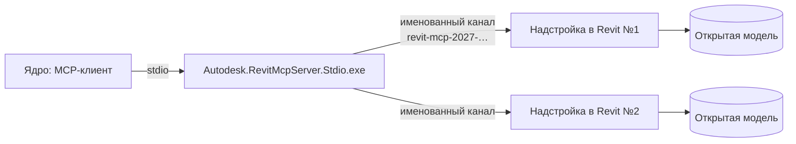

# Revit MCP — сервер Autodesk для Revit 2027

Страница описывает чужой компонент: MCP-сервер, который Autodesk ставит вместе с Revit 2027,
и то, как наше приложение с ним работает. Исследован на компьютере владельца 2026-11-15
(задачи T67, T68; требование UR51 в [PRODUCT](../PRODUCT.md)).

## Что это

| | |
|---|---|
| Продукт | «Autodesk Revit 2027 MCP Server Experimental-Tools Technical Preview» |
| Версия | сервер `0.4.0-preview`, надстройка `27.2.0.0`, установщик `27.0.0.19` (установлен 2026-11-04) |
| Папка | `C:\Program Files\Autodesk\Revit 2027 MCP Server Experimental-Tools Technical Preview\` |
| Запуск | `Autodesk.RevitMcpServer.Stdio.exe` без аргументов (.NET 10) |
| Транспорт | stdio — как наши `aec-rag` и `aec-sources` |
| Статус у Autodesk | технический предварительный выпуск; в программе есть сообщение «This Technical Preview feature is no longer available» и флаг `--expired=true` — Autodesk может отключить его выпуском |

## Как устроен

Как читать: сам `Stdio.exe` почти пустой — у него один инструмент,
`get_running_revit_instances`. Остальные инструменты принадлежат надстройке внутри каждого
запущенного Revit. Надстройку подгружает Revit Assistant
(`Revit 2027\AddIns\Assistant\Autodesk.Assistant.Loader.addin`); своего `.addin` у сервера нет.
Надстройка открывает именованный канал `\\.\pipe\revit-mcp-2027-<id>`; `Stdio.exe` находит
такие каналы, забирает у каждого Revit его инструменты и сообщает клиенту
`tools/list_changed` — «список инструментов изменился, запроси заново».

Отсюда три следствия:

- **Без запущенного Revit инструментов нет.** Revit должен быть открыт; для работы с моделью —
  с открытым проектом. Autodesk в описании инструментов просит держать Revit в режиме
  «Изменить» (Modify) без открытых диалогов.
- **Инструменты появляются не сразу**, а через секунды после подключения, уведомлением.
  MCP-клиент ядра такие уведомления обрабатывает (`tools/mcp_tool_health.py` в
  `runtime/.hermes-src`) и перерегистрирует инструменты вместе с их аннотациями — агент в
  чате получает полный список. Кнопка проверки сервера в окне MCP так не умеет (см. ниже).
- **Каждый вызов называет процесс Revit** (`revitInstanceId`). Если Revit один, сервер
  выбирает его сам; если два — отвечает ошибкой со списком процессов, и модели приходится
  сначала спросить `get_running_revit_instances`.

## Инструменты

Сервер отдаёт 40 инструментов; аннотацию ставит только одну — `readOnlyHint` (истина или
ложь). `destructiveHint` нет ни у одного, в том числе у `delete_elements`. Сверх MCP каждый
инструмент помечен уровнем выпуска Autodesk (`_meta`, ключ
`com.autodesk.revit/PublicMcpServer.releaseStatus`): `Stable` или `Experimental`.

Флаг запуска `--tool-permission=<уровень>` ограничивает набор:

| Флаг | Инструментов | Что входит |
|---|---|---|
| без флага | 40 | все, включая экспериментальные |
| `--tool-permission=Stable` | 12 | стабильные: чтение + `modify_element_parameters`, `move_elements`, `rotate_elements` |
| `--tool-permission=StableReadOnly` | 9 | только стабильное чтение |

**Чтение (22, `readOnlyHint: true`):** `get_running_revit_instances`, `get_active_context`
(активный документ, вид, выделение), `query_model` (поиск элементов по категории, виду,
параметрам), `get_element_data` (параметры элементов), `get_views`, `get_rooms`,
`get_room_boundaries`, `get_sheets`, `get_views_on_sheets`, `get_sheet_collections`,
`get_sheets_in_sheet_collection`, `get_all_schedules`, `get_schedule_definition`,
`get_schedulable_fields`, `get_all_view_templates`, `get_fill_and_line_patterns`,
`get_annotation_include_categories`, `review_changes` (что изменил последний пишущий
вызов), а также три, которые модель не меняют, но действуют: `open_view`, `select_elements`,
`show_elements` (переключают вид и выделение в окне Revit) и `export_views` — **пишет файлы
на диск** (PNG, PDF, CSV) и при этом помечен «только чтение».

**Запись (18, `readOnlyHint: false`):** `modify_element_parameters`, `move_elements`,
`rotate_elements`, `delete_elements`, `create_sheet`, `rename_sheet`, `set_sheet_number`,
`create_plan_views`, `create_section_view`, `create_schedule`, `modify_schedule_filters`,
`modify_schedule_grouping`, `modify_schedule_sorting`, `override_elements_graphics`,
`tag_elements`, `set_annotation_include_categories`, `export_ifc`, `export_gbxml`.

Каждый пишущий вызов — одна транзакция Revit: её отменяет Ctrl+Z в Revit, а
`review_changes` показывает, что она добавила, изменила и удалила. Сохранять модель сервер не
умеет — файл `.rvt` на диске меняет только человек.

Описание `delete_elements` само просит модель переспросить человека перед удалением — это
текст для модели, а не проверка: сервер удалит и без вопроса.

Описание всех 40 инструментов — около 208 КБ JSON (у `query_model` в схеме перечислены все
категории Revit). Это заметная прибавка к контексту каждого хода модели.

## Как с ним работает наше приложение

Человек добавляет сервер сам: «Возможности» → «Коннекторы» → «Добавить своё» → поля
«Название» и «Команда запуска» (путь к `Stdio.exe`) → наше окно согласия «Установить».

Замеры 2026-11-15 (Revit 2027.3, проект владельца, стена 8995413, параметр «Комментарии»):

| Проверка | Результат |
|---|---|
| Ядро подключает сервер и получает инструменты Revit | 39 от надстройки + 1 свой + 2 служебных ядра (`list_resources`, `read_resource`) |
| Чтение (`get_active_context`, `query_model`, `get_element_data`) | отвечает без вопроса |
| Запись на `trust: untrusted`, ответ «отказ» | ядро спросило, в вопросе id элемента и новое значение; вызов до Revit не дошёл, значение прежнее |
| Запись на `trust: untrusted`, ответ «разрешить» | записано; `review_changes`: «0 added, 1 modified, 0 deleted» |
| Запись без `trust` | ядро читает как `full`: записано **без вопроса** |
| Окно MCP записывает сервер | `revit: command: <путь>` — **без `trust`** |
| Вставка пути к `.exe` в поле «Вставьте команду» | не распознаётся («Это не похоже на сервер»), поля заполняются руками |
| Кнопка проверки сервера в окне | показывает **один** инструмент — `get_running_revit_instances`: она подключается, спрашивает список и отключается раньше, чем Revit пришлёт свои |

После проверки «Комментарии» стены возвращены к прежнему пустому значению; в модели осталось
четыре отменяемые транзакции, файл не сохранялся.

Служебные `list_resources` и `read_resource` ядро добавляет само к серверу, у которого есть
ресурсы, без `readOnlyHint` — на `trust: untrusted` они тоже будут спрашивать.

## Как проверить

Пробы бесплатные, без модели; Revit 2027 должен быть запущен с открытым проектом.

- Через MCP-клиент ядра: `runtime/revit-mcp-live-probe.mjs` (+ `.py`) на временной копии
  `runtime/e2e-profile` (`AEC_HERMES_HOME`). Режим `read` — подключение, список с вердиктом
  ядра «чтение/запись», чтение контекста; режим `steps` — заданные вызовы с ответом «отказ»
  или «разрешить» (запись — только в документе, который назвал владелец).
- Путь человека в окне: `apps/desktop/e2e/acceptance/live-revit-mcp.spec.ts` (проект
  Playwright `acceptance-live`); без сервера или Revit позиции снимаются с причиной.
- Без Revit, в автотестах: заглушка `runtime/fixtures/revit-mcp-stub.py` и
  `runtime/revit-mcp-probe.mjs` — та же развилка «чтение/запись» на модели в памяти.

## Связанные решения

- UR51 и уточнение N2 в [PRODUCT](../PRODUCT.md), [решение 0020](../decisions/0020-revit-write-rule.md):
  явную просьбу инженера изменить модель агент не переспрашивает, своё решение даёт планом;
  правило держит навык `skills/aec-revit/SKILL.md`, а не программа.
- Как ядро решает, спрашивать ли: `trust` сервера (`full` или `untrusted`; пропуск — `full`)
  и `readOnlyHint` инструмента, прочитанный при подключении; на `untrusted` спрашивает
  каждый вызов без `readOnlyHint: true` — `tools/mcp_tool.py` и `tools/mcp_tool_handlers.py`
  в `runtime/.hermes-src`.
