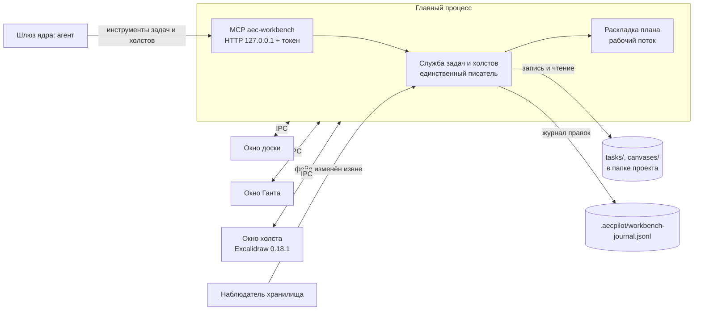

# Задачи, Гант и холсты

!!! warning "Планируется — версия 0.2"
    Кода ещё нет. Страница описывает утверждённое устройство (решение
    [0025](../decisions/0025-tasks-canvases-module.md), требования
    [PRODUCT](../PRODUCT.md) UR58–UR63) и будет уточнена по мере сборки.

## Что это для инженера

У каждого проекта три вида, каждый в своём окне:
- **доска задач** (канбан) — колонки-статусы и карточки;
- **диаграмма Ганта** по срокам карточек;
- **холсты** — сколько угодно, в духе Miro: схемы, картинки, листы PDF, заметки.

Задачи и холсты связаны:
- карточка задачи лежит на холсте живой;
- объект холста можно привязать к задаче;
- из карточки задачи открывается холст на нужном месте.

Агент читает и меняет всё это своими инструментами. Каждая его правка отмечена в истории, а
кнопка «Отменить правки агента за этот запрос» откатывает их разом.

## Как устроено

Как читать:
- **Окна.** Они только показывают и отдают действия человека главному процессу. Сами файлы не
  пишут.
- **Служба.** Пишет одна служба. После каждой правки она рассылает событие всем окнам проекта,
  поэтому изменение, сделанное в одном окне или агентом, сразу видно в остальных.
- **Агент.** Приходит к той же службе через MCP-сервер внутри главного процесса. Удаление
  карточек и холстов и перенос сроков больше чем у пяти задач служба не выполняет сразу: она
  возвращает список на подтверждение человеку.
- **Раскладка по исполнителям.** Своя функция последовательной расстановки: задачи по порядку
  зависимостей и приоритета ставятся на самого раннего свободного человека нужной роли.
  Результат ложится на Гант черновиком.

## Данные

| Файл | Что в нём |
|---|---|
| `tasks/<id>-<название>.md` | одна задача: YAML-шапка (статус, сроки, трудозатраты, исполнители, зависимости, вложения) и описание; ниже — комментарии |
| `tasks/people.yaml` | исполнители проекта: имя, роли, цвет |
| `tasks/board.yaml` | колонки доски: статусы, цвета, порядок, скрытые |
| `canvases/<название>.excalidraw` | холст без картинок внутри |
| `canvases/<название>.files/` | картинки холста, в том числе страницы PDF |
| `.aecpilot/workbench-journal.jsonl` | журнал правок: кто, запрос агента, до и после |

Папки `tasks/` и `canvases/` в индекс документов не попадают.

## Код

- `apps/desktop/src/main/workbench/` — служба и MCP-сервер (будет создано).
- `apps/desktop/src/renderer/src/aec/workbench/` — окна доски, Ганта, холста (будет создано).
- `apps/desktop/src/shared/vendor/dotpm/` — копия dotpm с заголовками происхождения (будет
  создано).
