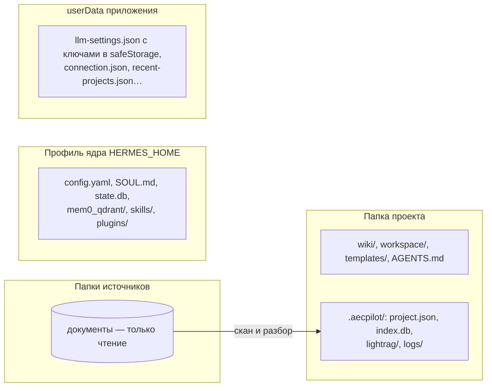
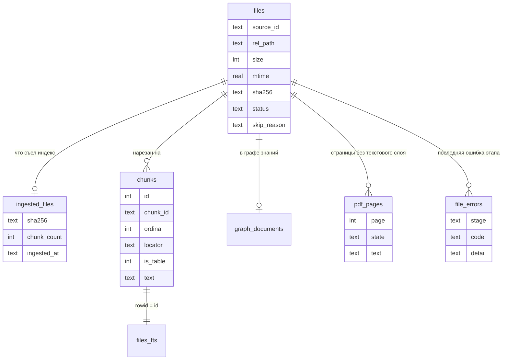

# Данные

Источник истины — файлы ([решение 0004](decisions/0004-files-first-storage.md)). Серверов
баз данных нет: проект — это папка, индекс — файлы SQLite и LightRAG внутри неё, профиль
агента — каталог ядра, настройки окна — файлы JSON. Бэкап проекта — копия его папки.

## Где что лежит

Как читать: четыре места хранения. Источники продукт только читает; всё, что продукт
узнал о документах, лежит в `.aecpilot/` папки проекта. Профиль ядра хранит разговоры и
память агента, `userData` — настройки окна и шифрованные ключи. В установленной программе
профиль и `userData` лежат под `<root>/data`.

## Папка проекта (vault)

Создаётся генератором `apps/desktop/src/project/vault-generator.ts`:

| Путь | Что там |
|---|---|
| `AGENTS.md` | правила агента для проекта, из шаблона `runtime/templates/AGENTS.md` |
| `wiki/` | вики проекта: `index.md`, `log.md`, `entities/`, `concepts/`, `comparisons/`, `queries/`, снимки источников в `raw/` (`aec_rag/wiki.py`) |
| `workspace/` | черновики и рабочие файлы агента и человека |
| `templates/` | шаблоны документов |
| `Makefile` | технический маркер: по нему ядро находит корень для снимков файлов (откат правок агента) |
| `.aecpilot/project.json` | описание проекта: источники, настройки, выбор графа, исключения |
| `.aecpilot/index.db` | индекс первого уровня (SQLite) |
| `.aecpilot/lightrag/` | хранилище LightRAG: векторы (NanoVectorDB), ключ-значение (JSON), граф (NetworkX); `aec-index.json` — модель эмбеддингов и язык графа |
| `.aecpilot/logs/` | журналы проекта, в том числе `sources-rejected.jsonl` |
| `.aecpilot/wiki-state.json` | отпечатки страниц вики для поиска правок человека |
| `.aecpilot/server-state.json`, `server-request.json` | обмен клиента и сервера ([сценарий](flows/server-client.md)) |

### `project.json`

Схема — `apps/desktop/src/project/project.schema.json` (документ), проверка —
`apps/desktop/src/project/project-config.ts`, функция `validateProjectConfig`.

| Поле | Что значит |
|---|---|
| `schema_version` | версия формата, сейчас 1; другое значение не открывается |
| `name`, `created_at` | имя проекта и время создания |
| `sources[]` | `id`, `root_path` (абсолютный путь), `added_at` |
| `settings.wiki_lang` | язык вики: `auto` или код языка |
| `settings.scan_interval_s` | интервал сканирования, секунды (300 по умолчанию) |
| `settings.embedding_model` | модель эмбеддингов индекса (пусто — не настроена) |
| `settings.extraction_language` | язык имён сущностей графа (`Russian`, `English`) |
| `graph_scope.entries[]` | папки и файлы, отмеченные человеком для графа знаний |
| `project_index[]` | файлы самого проекта (вики, черновики), включённые в индекс |
| `index_exclude[]` | файлы и папки источников, убранные человеком из индекса |

## Индекс `index.db`

Схема — `mcp/aec_rag/src/aec_rag/db.py`, константа `_SCHEMA`. Таблицы связаны по паре
`(source_id, rel_path)` — источник и путь файла в нём; внешних ключей нет, связи держит код.

Как читать: прямоугольник — таблица, линия — связь, значки на концах — сколько строк с
каждой стороны (`||` — ровно одна, `o|` — ноль или одна, `o{` — ноль или много).

| Таблица | Что хранит |
|---|---|
| `files` | взгляд сканера на диск: каждый файл источника, размер, время изменения, sha256, состояние `ok` / `changed` / `deleted` / `detached`, причина пропуска |
| `ingested_files` | взгляд индекса на себя: какой sha256 файла съеден и сколько фрагментов дал. Разница sha256 с `files` и есть «что переиндексировать» |
| `chunks` | фрагменты: текст, порядковый номер, локатор (страница, лист и диапазон, заголовок), признак таблицы |
| `files_fts` | полнотекстовый индекс SQLite FTS5 по тексту фрагментов |
| `graph_documents` | какие документы и при каком содержимом добавлены в граф знаний |
| `pdf_pages` | страницы PDF без пригодного текстового слоя: ожидают, распознаны (с текстом — чтобы не распознавать дважды) или с ошибкой |
| `file_errors` | последняя ошибка файла на этапе `index` или `graph`: код из закрытого списка и текст библиотеки |

Векторы фрагментов лежат не в SQLite, а в хранилище LightRAG — под теми же `chunk_id`.

## Профиль ядра

`runtime/dev-profile` в разработке, `<root>/data/profile` в установке, временная копия
`runtime/e2e-profile` в автотестах. Главное, что в нём лежит:

| Файл или папка | Что там | Кто пишет |
|---|---|---|
| `config.yaml` | конфиг ядра: модель, наборы инструментов, наши MCP-серверы и плагины, навыки | ядро и главный процесс |
| `SOUL.md` | личность агента по умолчанию | главный процесс до первого запуска ядра |
| `state.db` | сессии и сообщения | ядро |
| `memories/` | записка ядра — первый слой памяти | ядро |
| `mem0_qdrant/`, `mem0.json` | второй слой памяти: локальное хранилище Mem0 и его настройки | плагин Mem0, главный процесс |
| `aec-providers.json` | выбор провайдеров индекса и памяти | главный процесс |
| `aec-memory.json` | переключатель автозаписи памяти | плагин фильтра |
| `aecpilot-roster.json` | снимок списка специалистов для `aec-roster` | главный процесс |
| `profiles/` | профили специалистов | ядро |
| `skills/`, `plugins/` | навыки и плагины профиля, копии поставляемых навыков | ядро, главный процесс |
| `cron/` | расписания | ядро |
| `logs/`, `serve.log` | журналы ядра | ядро, `serve.mjs` |

Ключи провайдеров в профиль **не пишутся**: их значения приходят в ядро через окружение
процесса ([решение 0014](decisions/0014-credentials-storage.md)). OAuth-токены входа по
подписке хранит ядро в своём файле учётных данных профиля.

## Настройки приложения (`userData`)

В разработке — папка Electron по умолчанию (`%APPDATA%\@aecpilot\desktop`), в установке —
`<root>/data/userData`.

| Файл | Что там |
|---|---|
| `llm-settings.json` | модель, адрес провайдера и ключи провайдеров — каждый ключ зашифрован safeStorage (DPAPI на Windows), в файле только шифротекст в base64 |
| `connection.json` | своё ядро, удалённый шлюз или SSH; токен — шифрованно |
| `server-token.json` | постоянный токен шлюза серверной установки, шифрованно |
| `recent-projects.json` | недавние проекты |
| `chat-sessions-by-project.json` | какие сессии относятся к какому проекту |
| `project-skills-trust.json` | доверие к навыкам проектов |
| `ui-language.json`, `agent-language.json`, `zoom.json`, `keep-awake.json`, `minimize-to-tray.json`, `devtools-block.json` | настройки окна |
| `attachments/` | вложения чата |
| `logs/desktop.log` | журнал приложения |

## Установленная программа: `<root>/data`

Всё, что пишет продукт и его дочерние процессы, остаётся под папкой установки
(`apps/desktop/src/main/data-root-pure.ts`): `profile/`, `userData/`, `cache/` (в том
числе `huggingface/`, `npm/`), `tmp/` (`TEMP` для всех дочерних процессов), `config/`,
`npm/` (глобальные пакеты, которые ставит агент), `index-locations.txt` (папки проектов,
чьи индексы предложит удалить деинсталлятор).

## Срок хранения, резервные копии, миграции

- **Срок хранения.** Ничего не удаляется само: сессии, память и индекс живут, пока их не
  удалит человек. Журнал отклонённых попыток источников ротируется при 1 МиБ (одно
  прошлое поколение).
- **Удаление.** Деинсталлятор по умолчанию сохраняет `<root>/data` и индексы проектов;
  документы и папки проектов не трогает никогда ([установка](components/packaging.md)).
- **Резервная копия** проекта — копия его папки вместе с `.aecpilot/`; профиля — копия
  `<root>/data`.
- **Миграции.** Отдельного механизма нет. `project.json` несёт `schema_version: 1`;
  таблицы `index.db` создаются через `CREATE TABLE IF NOT EXISTS`, поэтому новая таблица
  появляется при следующем открытии. Индекс, построенный другой моделью эмбеддингов или с
  другим языком графа, не открывается — его перестраивают целиком (`aec-rag ingest
  --rebuild`). Совместимость профиля ядра с новой версией проверяется при подъёме пина
  ([эксплуатация](operations.md)).
