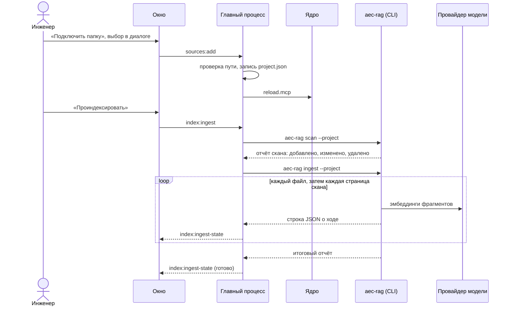

# Подключение источника и индексация

## Коротко

Инженер подключает к проекту папку с исходными данными и запускает «Проиндексировать».
Приложение сканирует папку, разбирает документы, режет их на фрагменты с местом в файле
и строит индекс для поиска; сканы распознаются вторым проходом. Дальше приложение само
пересканирует источники по расписанию и замечает новые и изменённые файлы. Граф знаний —
отдельный платный шаг только по выбору человека. Участвуют: окно, главный процесс,
командная строка [aec-rag](../components/aec-rag.md) и провайдер модели (эмбеддинги).

## Последовательность



Как читать: время идёт сверху вниз; цикл повторяется для каждого файла первого прохода и
каждой страницы второго. Индексация идёт мимо агента — ядро участвует только в том, что
перезапускает свои MCP-серверы с новым списком источников.

## По шагам

1. Инженер выбирает папку в системном диалоге. Главный процесс принимает только путь,
   выбранный в диалоге этого процесса (находка D-47): источник уходит в индекс, в векторы
   и в запросы к модели целиком. Код: `apps/desktop/src/main/index.ts`, обработчик
   `sources:add`.
2. Путь проверяется (`apps/desktop/src/project/source-validation.ts`): папка проекта и
   источник не могут быть вложены друг в друга, точный повтор запрещён; пересечение с
   другим источником или недоступная папка требуют подтверждения. Источник
   дописывается в `.aecpilot/project.json` (`project-manager.ts`, `addSourceToProject`).
3. Главный процесс просит ядро перезапустить MCP-серверы (`reloadMcp`) — иначе уже
   запущенный `aec-sources` отдавал бы агенту старый список. Сессия чата при этом
   сохраняется.
4. «Проиндексировать» (`index:ingest`) запускает индексацию первого уровня. Одновременно
   идёт не больше одной индексации: второй запуск получает ответ «уже идёт».
5. Сначала свежий скан: индексация берёт только просканированные файлы, а очередной скан
   по расписанию мог ещё не пройти (находка D-114):

    ```ts title="apps/desktop/src/main/index.ts"
    --8<-- "apps/desktop/src/main/index.ts:ingest_after_scan"
    ```

6. Скан (`aec-rag scan`, `mcp/aec_rag/src/aec_rag/indexer.py`) сверяет диск с таблицей
   `files`: размер, время изменения, sha256. Исчезнувший файл помечается удалённым.
7. Индексация (`aec-rag ingest`, `mcp/aec_rag/src/aec_rag/ingest.py`) берёт файлы, чей
   sha256 отличается от уже съеденного, разбирает, режет и записывает их; в окружении
   процесса — расшифрованный ключ провайдера эмбеддингов (`buildExtraEnv`). Каждое
   событие — строка JSON в stdout; главный процесс читает её (`ingest-runner.ts`,
   `ingest-progress-pure.ts`) и публикует ход окну каналом `index:ingest-state`.
8. Второй проход распознаёт страницы PDF без текстового слоя, по одной. Файл доступен
   поиску уже после первого прохода; распознанные страницы добавляются к нему по мере
   готовности.
9. Расписание (`scan-scheduler.ts`) пересканирует источники открытого проекта каждые
   `scan_interval_s` секунд (300 по умолчанию). Окно показывает уведомление, только если
   что-то добавилось, изменилось или исчезло (`aec/scan/ScanWatcher.tsx`); скан без
   изменений молчит. Изменённые файлы попадают в индекс при следующей индексации.
10. Граф знаний (уровень 2): в проводнике — «Добавить в граф» на папке или файле. Сначала
    `graph:preview` считает документы и фрагменты и ничего не пишет; только согласие
    человека запускает `graph:add` (`aec-rag graph-add`), который зовёт модель на каждый
    фрагмент. Выбор сохраняется в `project.json` — новые файлы в отмеченной папке ждут
    следующего явного добавления.

## Когда что-то идёт не так

- **«Остановить»** — главный процесс пишет `stop` в стандартный ввод `aec-rag`; прогон
  останавливается на следующем файле или странице, сделанное сохраняется, следующий
  прогон продолжает. Если за 20 с процесс не остановился, он завершается принудительно, а
  незаконченный файл будет прочитан заново, о чём окно сообщает.
- **Процесс замолчал** — прогон считается зависшим через 15 минут без единой строки
  вывода (не по общей длительности: распознавание большого отчёта идёт часами, но
  каждая страница — строка); скан ограничен 10 минутами.
- **Один файл не читается** — ошибка записывается с кодом причины (`file_errors`), прогон
  идёт дальше; страница «Индекс» показывает причину у файла.
- **Нет ключа провайдера** — фрагменты без векторов не появляются; отказ провайдера
  записывается как ошибка файла, а не обрывает весь прогон.
- **Сменилась модель эмбеддингов** — индекс, построенный другой моделью, не открывается;
  окно предлагает перестройку (`--rebuild`) с вопросом о цене.
- **Источник недоступен** (сетевая папка отключена) — скан отмечает корень недоступным и
  не считает его файлы удалёнными.
- **Переключение проекта посреди прогона** — отчёт прогона относится к проекту, для
  которого он начат, и не попадает в индикатор другого проекта.
- **Ядро на сервере** — индексирует и сканирует сервер своими дисками и своим `aec-rag`;
  клиент только показывает ход ([сервер и клиент](server-client.md)).

## Связанное

- [aec-rag](../components/aec-rag.md), [главный процесс](../components/main-process.md),
  [данные](../data.md)
- [Решение 0005](../decisions/0005-two-tier-indexing.md) — два уровня индексации
- Контракт функции — [workspace-sources](../history/specs/workspace-sources.md)
