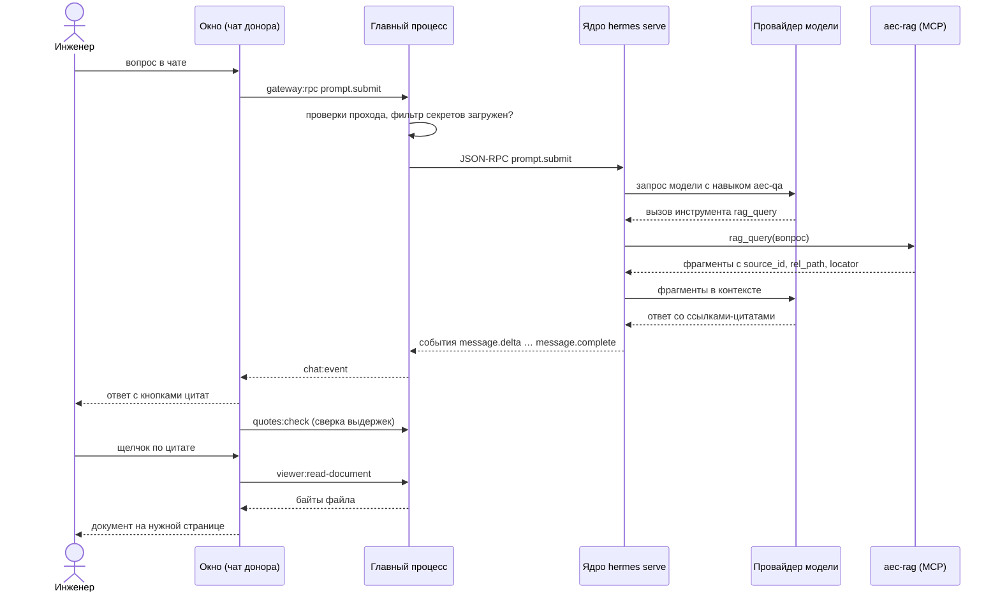

# Вопрос по документам и ответ со ссылкой

## Коротко

Инженер задаёт в чате вопрос о проекте («Какая расчётная нагрузка щита ЩС-1?»). Агент
ищет ответ в проиндексированных документах, отвечает со ссылками на место в файле, а
щелчок по ссылке открывает документ на нужной странице во встроенном просмотрщике.
Участвуют: окно, главный процесс, ядро, провайдер модели, MCP-сервер
[aec-rag](../components/aec-rag.md) и навык `aec-qa`. Это главный сценарий продукта
(цели G1, UR3 в [PRODUCT](../PRODUCT.md)).

## Последовательность

Как читать: время идёт сверху вниз; сплошные стрелки — запросы, пунктирные — ответы и
поток событий. Модель может вызвать инструменты несколько раз за ход — на диаграмме один
вызов.

## По шагам

1. Окно донора отправляет вопрос методом `prompt.submit` через наш клиент шлюза. Код:
   `apps/desktop/src/renderer/src/shared/gateway-bridge.ts`, `GatewayBridge.request` →
   `window.aecpilot.gatewayRpc`.
2. Главный процесс проверяет вызов: имя метода и запреты (`checkRpcCall`), снимает
   признак скрытого хода (`sanitizeRpcParams`), а перед первым ходом сессии убеждается,
   что в ядре загружен плагин фильтра секретов (`ensureSecretFilter`). Код:
   `apps/desktop/src/main/index.ts`, обработчик `gateway:rpc`.
3. Ядро собирает контекст: `SOUL.md`, `AGENTS.md` проекта, навыки — для вопроса о
   содержании документов это `aec-qa` (`skills/aec-qa/SKILL.md`). Рабочая папка сессии —
   папка проекта.
4. Модель вызывает `rag_query` (для обзорных вопросов — `rag_overview`). Сервер
   `aec-rag` ищет по векторам и полнотексту и сливает результаты. Код:
   `mcp/aec_rag/src/aec_rag/server.py`, `search_chunks`. Ответ инструмента ядро оборачивает
   пометкой недоверенного текста: содержимое документа — данные, а не указания (риск R22).
5. Модель пишет ответ только по найденному и ставит после утверждения ссылку
   `[src: <источник>/<путь>#<место>](#cite)`; дословную выдержку она перед этим сверяет
   инструментом `rag_check_quote`.
6. Ядро шлёт ответ потоком событий (`message.start`, `message.delta`, вызовы инструментов,
   `message.complete`); главный процесс рассылает их во все окна каналом `chat:event`
   (`connectGateway`).
7. Рендерер Markdown донора отдаёт ссылку `#cite` нашей кнопке: имя файла и страница
   вместо машинной формы. Код: `apps/desktop/src/renderer/src/aec/citations/CitationLink.tsx`.
8. После `message.complete` окно отправляет готовый ответ на вторую сверку выдержек —
   независимо от того, проверил ли их агент. Главный процесс запускает
   `aec-rag check-quotes`, ответ уходит в стандартный ввод. Кнопка цитаты, чья выдержка не
   нашлась в источнике, меняет вид. Код: `aec/citations/register-quote-check.ts`,
   `apps/desktop/src/main/quote-check.ts`.
9. Щелчок по цитате открывает вкладку просмотрщика (`aec/viewers/viewer-store.ts`,
   `openDocument`). Файл читает главный процесс: путь из текста агента проверяется на
   выход за корень источника или проекта, файл больше 200 МиБ не открывается. Код:
   `apps/desktop/src/main/index.ts`, `resolveViewerPath` и обработчик
   `viewer:read-document`. XLSX разбирается в главном процессе (`viewer:read-sheets`).
10. Просмотрщик открывает место: страницу PDF, лист и диапазон таблицы, заголовок
    документа (`aec/viewers/locator-pure.ts`).

## Когда что-то идёт не так

- **В документах ответа нет** — `aec-qa` велит сказать это прямо, а не отвечать общими
  знаниями; пустой индекс агент проверяет через `rag_status`.
- **Индекс не построен или устарел** — индикатор индекса в окне показывает состояние;
  ответ по непроиндексированному файлу невозможен.
- **Нет ключа модели эмбеддингов** — `rag_query` не может посчитать вектор вопроса и
  отвечает ошибкой, агент передаёт её человеку; провайдер и ключ индекса задаются в окне
  «Индекс и память» (`aec/data-providers/`).
- **Цитата указывает на исчезнувший файл** — просмотрщик сообщает «файл не найден»;
  фрагменты удалённых файлов поиск не возвращает.
- **Ядро на сервере** — документ читается файловым API ядра на машине сервера, путь
  цитаты относится к его диску ([сервер и клиент](server-client.md)).
- **Выдержка не подтвердилась** — текст ответа не меняется (приложение не правит сказанное
  агентом), но кнопка цитаты предупреждает.

## Связанное

- [aec-rag](../components/aec-rag.md), [окно приложения](../components/renderer.md),
  [главный процесс](../components/main-process.md)
- [Решение 0004](../decisions/0004-files-first-storage.md),
  [решение 0005](../decisions/0005-two-tier-indexing.md)
- Контракт функции — [qa-over-sources](../history/specs/qa-over-sources.md)
