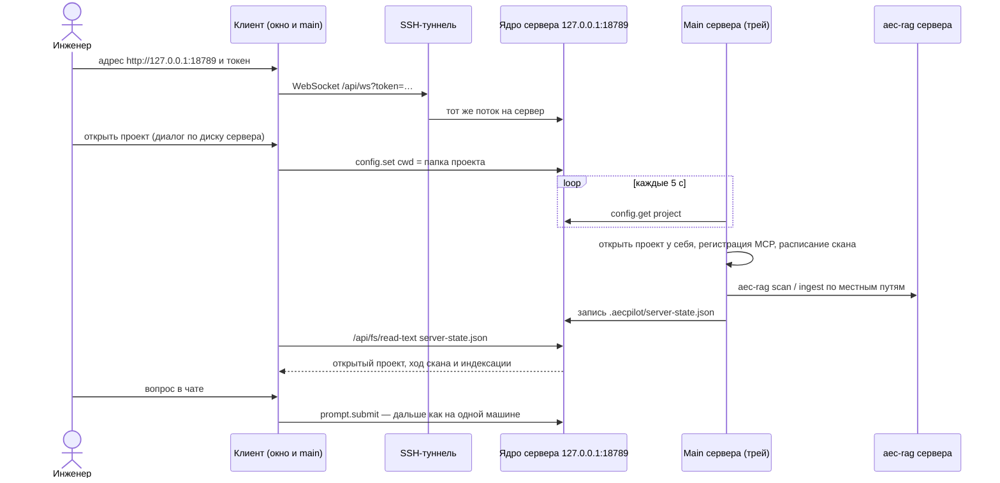

# Сервер и клиент

## Коротко

Документы лежат на машине в офисе, инженер работает с ноутбука. На машину с документами
AECPilot ставится в режиме «Только сервер»: ядро, MCP-серверы, индекс и проекты живут
там, окна нет — только значок в трее. На ноутбук ставится «Только приложение»: окно без
своего ядра. Ноутбук приходит к шлюзу сервера через SSH-туннель с постоянным токеном,
открывает проект на диске сервера, а индексирует и сканирует сервер — в том числе когда
ноутбук закрыт ([решение 0008](../decisions/0008-server-client-profiles.md)).

## Последовательность

Как читать: время идёт сверху вниз. Шлюз сервера слушает только 127.0.0.1, поэтому все
вызовы клиента идут через туннель SSH. Клиент и сервер не говорят друг с другом
напрямую: клиент меняет рабочую папку ядра сервера, сервер замечает это, а обратная
связь лежит файлом в проекте, который клиент читает файловым API ядра.

## По шагам

1. **Сервер.** Установщик в режиме «Только сервер» пишет `server` в
   `<root>/install-mode.txt` и заводит задачу Windows: `AECPilot.exe --server` при входе
   пользователя. Второй запуск сразу выходит — сервер на машине один. Код:
   `apps/desktop/build/installer.nsh`, `apps/desktop/src/main/index.ts` (роль `server`).
2. **Токен.** Сервер создаёт постоянный токен шлюза один раз и хранит его
   зашифрованным safeStorage (`server-token.ts`); меню трея — «Скопировать токен
   подключения», «Выдать новый токен», «Ключи моделей…», «Остановить сервер»
   (`server-tray.ts`). Ключи моделей вводятся на самом сервере окном из трея
   (`server-keys-window.ts`) и не покидают его.
3. **Туннель.** Инженер поднимает проброс порта:
   `ssh -N -L 18789:127.0.0.1:18789 пользователь@сервер`. Шифрование и проверка личности —
   у SSH; сам шлюз в сети не виден (ограничение C11).
4. **Клиент.** «Настройки» → «Шлюзы» → «Удалённый шлюз»: адрес
   `http://127.0.0.1:18789` и токен; токен хранится в safeStorage клиента
   (`connection.ts`). Главный процесс клиента подключает к этому адресу тот же
   `GatewayClient`, что и к своему ядру. Своего ядра у установки «Только приложение» нет.
5. **Проект.** Папку проекта и источники инженер выбирает в окне, которое показывает диск
   сервера. Клиент вызывает у ядра сервера `config.set {key: 'cwd'}`: ядро само проверяет,
   что папка есть на его диске. Код: `remote-project-pure.ts`, `openRemoteProject`.
6. **Сервер следует за проектом.** Каждые 5 с main сервера спрашивает у своего ядра
   текущий проект и, увидев новый, открывает его у себя тем же
   `activateOpenedProject`, что и на одной машине: регистрирует `aec-sources` и `aec-rag`
   по местным путям, просит `reload.mcp`, запускает расписание сканирования
   (`followServerProject`).
7. **Обратная связь.** Сервер пишет `<проект>/.aecpilot/server-state.json`: какой проект
   открыт, на какой машине, идёт ли скан, чем кончился последний, ход индексации. Клиент
   читает его через `/api/fs/read-text` ядра.
8. **Просьбы клиента.** «Подключи источник» и «Проиндексируй» клиент записывает в
   `<проект>/.aecpilot/server-request.json` (`/api/fs/write-text`); сервер выполняет их
   своей проверкой и своим `aec-rag` (`handleServerRequest`) и кладёт итог в
   `server-state.json`.
9. **Вопросы и цитаты** идут как на одной машине ([сценарий](question-with-citation.md)),
   только документ для просмотрщика читается файловым API ядра на машине сервера.

Есть и второй способ подключения — режим SSH в настройках подключения
(`apps/desktop/src/main/ssh.ts`): приложение само запускает по SSH ядро на другой машине и
пробрасывает порт одной сессией `ssh`, с новым токеном на каждое подключение (токен уходит в
стандартный ввод, а не в аргументы). Туннель и ядро живут и умирают вместе.

## Когда что-то идёт не так

- **Сервер не отвечает** — проверить значок в трее («Сервер AECPilot работает»), что
  туннель поднят и что токен скопирован после последней выдачи нового.
- **Выдан новый токен** — старый перестаёт работать после перезапуска шлюза; клиенту
  нужен новый.
- **Сервер выключен** — клиент показывает состояние связи; работать без сервера
  установка «Только приложение» не может.
- **Индексация выборочно или с перестройкой** с клиента недоступна — только целиком;
  выборочно и с перестройкой — на самом сервере.
- **Многопользовательский режим** не входит в первую версию: одно подключение за раз,
  безопасность сервера равна безопасности SSH-доступа к нему (риск R17).

## Связанное

- [Главный процесс](../components/main-process.md), [установка и поставка](../components/packaging.md)
- [Решение 0008](../decisions/0008-server-client-profiles.md)
- Пользовательская инструкция — [быстрый старт](../quickstart.ru.md), раздел «Сервер и
  подключение к нему»
