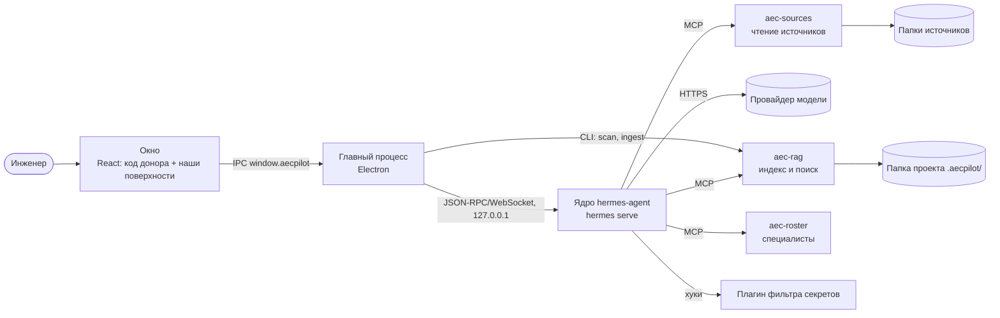

# AECPilot

**Рабочее место инженера-проектировщика с агентом:** проект объединяет рабочую папку,
подключённые папки исходных данных и агента, который отвечает на вопросы по документам со
ссылкой на место в файле, ведёт вики проекта и замечает новые редакции заданий.

## Из чего состоит

Как читать: инженер работает в окне; окно говорит только с главным процессом, а тот — с
ядром агента, которое запускает сам. Ядро ведёт разговор с моделью провайдера, которого
выбрал пользователь, и вызывает наши MCP-серверы: `aec-sources` читает папки источников,
`aec-rag` ищет по индексу проекта и отдаёт фрагменты с местом в файле, `aec-roster` даёт
спросить специалиста по имени. Индекс строит главный процесс той же программой `aec-rag`
напрямую. Подробно — [архитектура](ARCHITECTURE.md).

## Где мы сейчас

| Этап | Что дал | Состояние |
|---|---|---|
| [1](history/stage-1.md) | функционально готовый продукт на коде донора | закрыт 2026-10-14 |
| [2](history/stage-2.md) | ядро и донор на версии 0.22.2 | закрыт 2026-10-16 |
| [3](history/stage-3.md) | продукт в руках: установщик Windows с тремя режимами, сервер и клиент, всё в одной папке, приёмка | закрыт 2026-10-22 |
| 4 | после MVP | не начат — по слову владельца |

MVP собран. До выпуска ждут решения владельца: место публикации установщика, адрес файла
последней версии, подпись кода. Текущее состояние и следующий шаг — [TASKS](TASKS.md).

Последние решения: [0012 — ядро 0.22.2](decisions/0012-core-0-22-2.md),
[0013 — провайдера выбирает пользователь](decisions/0013-user-chosen-provider.md),
[0014 — хранение учётных данных](decisions/0014-credentials-storage.md),
[0015 — лицензии](decisions/0015-licensing.md).

## С чего начать чтение

1. [Продукт](PRODUCT.md) — что строим, для кого и как поймём, что работает.
2. [Архитектура](ARCHITECTURE.md) — части, стек и [журнал решений](decisions/index.md).
3. Главный сценарий: [вопрос по документам и ответ со ссылкой](flows/question-with-citation.md),
   затем [индексация](flows/indexing.md) и [сервер и клиент](flows/server-client.md).
4. Части изнутри: [главный процесс](components/main-process.md),
   [окно](components/renderer.md), [ядро](components/core-runtime.md),
   [aec-rag](components/aec-rag.md), [aec-sources](components/aec-sources.md),
   [расширения ядра](components/core-extensions.md),
   [установка и поставка](components/packaging.md).
5. [Данные](data.md), [эксплуатация](operations.md), [глоссарий](glossary.md).

Справочные материалы: [факты о ядре и доноре](core-facts.md),
[подробности плана](plan-details.md), [модель угроз](THREAT_MODEL.md),
[чек-лист ручной приёмки](manual-checklist.md), [отчёты приёмки](acceptance/README.md),
[быстрый старт](quickstart.ru.md) ([English](quickstart.en.md)).
