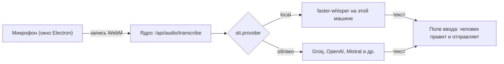

# Следующая версия: анализ перед обсуждением

Дата анализа — 2026-11-07. Это материал для обсуждения, а не утверждённый план: ни одно
решение отсюда ещё не принято, код продукта не менялся. Разработка идёт в ветке `next/0.2`,
версия 0.1.0 остаётся в `master`.

Откуда взяты сведения, помечено так: **замер** — проверено на нашей машине или прочитано в
исходниках; **заметки** — написано в заметках к выпуску и в коде не проверялось; **не
проверено** — предположение, которое нужно подтвердить до реализации.

## Коротко

| Вопрос | Вывод | Предложение |
|---|---|---|
| Какая версия ядра последняя | v0.23.0 «The Hearth Release», 2026-11-05; наш пин — v0.22.2 | Поднять на v0.23.0 |
| Сколько работы | В зоне донора у вендоренных файлов изменились 568 из 1764; прошлый подъём — 584 из 1438 | Отдельный этап размером с этап 2 |
| Главная развилка | Их окно перешло на серверные комнаты, то есть наступило условие возврата HX18 | Решить до начала подъёма |
| RAG и графы | LightRAG 1.5.6 → 1.5.7, Docling 2.118.1 → 2.148.0: есть полезные исправления | Поднять обе; sigma 4 и RAG-Anything не брать сразу |
| Голос | Диктовка реальна и стоит недорого; причина прежнего «перевода на английский» найдена с высокой вероятностью | Диктовка — да; чтение вслух — вторым шагом; разговор и слово-активатор — нет |
| MCP | Работает: сторонний сервер подключается и вызывается по stdio и по HTTP | Проверить на настоящем Revit после подъёма |

## Что произошло в ядре

Окно v0.22.2 → v0.23.0: 8170 коммитов (замер). В заметках v0.23.0 указано «с v0.22.0»: около
10 080 коммитов, 1950 PR и 850 закрытых задач. Промежуточные v0.22.3–v0.22.7 своих подробных
заметок не имели, их содержимое описано в заметках v0.23.0. Лицензия осталась MIT, Python 3.14
— прежний (замер).

Объём для нас (замер):

| Что | Значение |
|---|---|
| Изменённых файлов окна донора в целом | 829, из них в нашей зоне 568 |
| Удалённых | 21, из них в нашей зоне 10 |
| Новых файлов окна | 741, без тестов и переводов — 268 |
| Файлов зоны с нашими правками, которые надо наложить заново | 111 из 1764 |
| Методы RPC шлюза | убрано 3 (`browser.controller.*`), добавлено 5 (`groups.attachment.download`, `groups.continue`, `groups.discard`, `image.render`, `subagent.roster`) |
| Встроенные навыки | 58 → 44 |

## Что нового и что предлагаю

### Берём: приезжает с подъёмом и сразу полезно

| Функция | Что это значит для инженера | Основание |
|---|---|---|
| Сжатие контекста честнее | В сводке длинного чата непроверенные утверждения идут строками `UNVERIFIED:`, и догадка не возвращается как факт — для инженерной работы важно | заметки |
| Дешевле запросы | Меньше токенов на служебные вызовы, расписания используют общий кэш подсказки | заметки |
| Подробная карточка ошибки | Вместо «что-то пошло не так» — настоящая причина и одно действие: например, «Открыть настройки провайдера» | заметки |
| Вопрос агента одной формой | Несколько уточнений агента заполняются на одной форме с одной кнопкой | заметки |
| Быстрее длинные чаты | Ввод не тормозит при загрузке истории, боковая панель не замедляется при большом числе сеансов | заметки |
| Сообщение не теряется | Текст, отправленный перед закрытием окна, сохраняется; ответы не рисуются дважды после переподключения | заметки |
| Остановка расписания | Запущенную задачу можно остановить, для каждой задачи задаётся судьба пропущенных запусков | заметки; наш тик расписания (решение [0011](decisions/0011-schedule-tick-in-main.md)) надо сверить |
| Настройка субагентов списками | Провайдер и модель выбираются из списка, а не вводятся текстом | заметки |
| Доска задач | Рабочие карточек снова умеют делегировать и искать по сеансам, упавшая попытка освобождает место | заметки; связано с T45 |
| `/model reset` | Сеанс возвращается к модели по умолчанию без потери разговора | заметки |
| Тарифы с лимитами | Шкала остатка и время сброса по подписке (например, Codex) | заметки |
| Надёжнее свои адреса моделей | Новые профили наследуют `custom:<имя>`, возобновлённый чат остаётся на своём адресе. Это важно для решения [0013](decisions/0013-user-chosen-provider.md) | заметки |
| Особенности провайдеров | Блокировка Gemini показывается как отказ по политике и переходит на запасную модель; потоковые вызовы инструментов не ломаются | заметки |
| Безопасность | Маскируется больше видов секретов; проверка команд ловит `curl … | sudo bash` и сокращённые удаления в PowerShell; устаревшая карточка не подтверждает следующий запрос | заметки |
| Память шлюза | Закрытые сеансы освобождают память, исчезла заморозка раз в минуту | заметки |
| Mermaid через Pele | Диаграммы рисует меньшая библиотека (MIT, замер), окно становится легче | заметки; диаграммы проверить вручную |

### Берём ради MCP (Revit, Lira Support)

| Функция | Пример | Основание |
|---|---|---|
| Живой ход долгих вызовов | Расчёт идёт несколько минут, строка инструмента показывает проценты и сообщение сервера | заметки; сервер должен сообщать прогресс |
| Сервер объявляет свой предельный срок | Долгая операция не обрывается общим тайм-аутом инструмента | заметки |
| Понятные подтверждения | В запросе видны аргументы вызова; «разрешить на сеанс» действительно отключает следующие вопросы по этому инструменту | заметки |
| Согласие показывает команду | Перед подключением видна точная команда или адрес | заметки; сверить с нашим `aec/install-consent` |
| Большие ответы по HTTP | Результаты и списки инструментов больше 1 МиБ не ломаются | заметки |
| Свой дом у сервера в профиле | На шлюзе с несколькими профилями stdio-сервер получает дом своего профиля. Это касается наших специалистов | заметки |
| Цена вызова и лимит на чат | Платный инструмент показывает цену и спрашивает при превышении лимита | заметки; Revit не платный, берётся как часть подъёма |

### Обсудить

| Функция | Что даёт | Цена или условие | Мнение |
|---|---|---|---|
| **Серверные комнаты вместо наших групповых чатов** (HX18) | Комната живёт в ядре: ведущий специалист, автоматический выбор отвечающего, заметки комнаты, публикация из расписаний, предел обмена между ботами (4 шага) | Подробности — ниже | Перейти, если замер подтвердит, что не нужен внешний порт |
| **Маршрутизация субагентов** (`advanced-delegation`) | Поиск по документам идёт на дешёвой модели, итоговый ответ — на сильной | Официальный плагин ставится через наш гейт доверия | Настройки окна взять; плагин — после подъёма по отдельному решению |
| **Подготовка сводки заранее** (`compression.prepare_ahead`) | Сжатие длинного чата больше не останавливает ход | По умолчанию выключено; сводка пишется фоновым запросом модели | Включить после замера на длинном сеансе |
| **Поиск Яндекса** (плагин каталога) | Поиск по русскоязычным источникам и нормативам | Качество плагина и его ключ не проверены | Посмотреть плагин; для нас это может быть заметной ценностью |
| **Обновить промпты в идущих сеансах** (`hermes sessions refresh-prompts`) | Изменённый SOUL или навык применяется без нового сеанса | Команда консольная; нужна кнопка | Небольшая отдельная задача, если она вам нужна |
| **Веб-приложение** (`webapp.enabled`) | Рабочее место открывается в браузере, без установки у коллег | Слушающий порт; вход с публичного адреса идёт через Nous (заметки); сейчас под HX3 и HX10 | В этой версии нет; это естественный путь к N16 (многопользовательский сервер) |
| **Несколько ядер в одном окне** | Переключение между компьютером и сервером мгновенное | Сейчас исключено HX22 (одно подключение за раз); затрагивает host и маршруты плагинов | Оставить HX22, если вы не работаете с двумя машинами постоянно |

**Подробно о серверных комнатах.** HX18 говорит: «Возврат — если их клиент перейдёт первым» —
и теперь он перешёл (замер: вызовов `groups.*` в их окне было 0, стало в 38 файлах). Ход круга
по-прежнему можно вести из окна: файл `group-rounds.ts` остался, режим `legacy` существует. Но
окно выбирает его только когда шлюз сообщает `driver: false`, а `hermes serve` сообщает о своём
драйвере сам. Значит, чтобы оставить старый путь, придётся это проверить и, возможно, держать
его вне разрешённых шести правок. Не проверено: нужен ли драйверу порт (HX10 запрещает
слушающий порт), как он сочетается с нашим `mcp/aec_roster`. Это первая задача этапа.

### Не берём

| Функция | Причина |
|---|---|
| `/rewind`, картинки в терминале, новый вид CLI, новый TUI | В заметках — только консоль; у нас нет консольной поверхности (HX9, HX10). Возврат к прежнему сообщению в окно можно попросить отдельно |
| Вкладки терминала по машинам | Панель терминала убрана (HX7-прим) |
| Самообновление плагинов (`plugins.auto_apply`) | Код из сети без нашего гейта; принудительно держать выключенным (решение [0012](decisions/0012-core-0-22-2.md), п. 6) |
| Загрузка плагинов окна, расширенный SDK плагинов | HX5 |
| Менеджеры паролей в браузере, ключ в системном хранилище | HX24 (хранилище паролей), отдельным решением |
| Hermes Cloud, Daybreak, бесплатный гость, удалённая конфигурация флота | HX2, HX3; к инженерной работе не относятся |
| Meshy, ElevenLabs Music, X Chat, REA и подобные | Без сценария у инженера КР (HX11) |
| События MCP через вебхуки | Экспериментально и нужен слушающий порт; вернуться, если Revit или Lira Support будут слать события |
| `electron-builder` 27 alpha, Vite 8 у них в сборке | Альфа-версия; у нас свой стек. Vite поднимать, только если потребует код донора |

## Что может сломаться при подъёме

Это ловушки, а не функции. Все они попадают в первые задачи этапа.

| Изменение | Где у нас | Что сделать |
|---|---|---|
| Удалены `browser_navigate`, `browser_click` и ещё восемь инструментов, остался `browser_exec` | `apps/desktop/src/main/index.ts`, `runtime/tool-registry.test.mjs`, `runtime/untrusted-tools.test.mjs`, `runtime/browser-probe.mjs`, `ac1-clean-machine.spec.ts` | Обновить списки; граница безопасности R22 обязана знать новый инструмент |
| Удалён `agent-browser` | `runtime/payload/stage_core.py` (`TOOLS`) | Сверить с их замком: поставка, возможно, станет легче |
| Docx, Xlsx и PowerPoint слиты в `microsoft-office`; `llm-wiki` стал необязательным | `agent-defaults-pure.ts` | Обновить список. `aec-wiki` — наш файл, удаление его не затрагивает |
| Один шлюз владеет сеансами | `hermes serve --isolated`, `cron-runner.ts` (`gateway run`) | Проверить, что нет двух писателей одной истории. Это главный архитектурный риск подъёма |
| Стратегия делегирования стала встроенным плагином | `plugins.enabled` в профиле | Проверить `delegate_task`: `runtime/delegate-probe.mjs` |
| Плагины, выделенные из ядра, ставятся сами из сети (Copilot, Camofox и другие) | Профиль | Проверить, что наш запрет ленивых установок это закрывает |
| Удалён `tools/mcp_death_supervisor.py`, изменён надзор за MCP | Наши серверы (D-153) | Прогнать `runtime/mcp-health-probe.mjs` |
| Electron 44 | У нас 43.8.3 | Поднять отдельным шагом |

Дефект подписи A2A (T49) **в v0.23.0 не исправлен** (замер): подпись считается по
отсортированному JSON (`plugins/platforms/a2a/security.py`, `sign_push_payload`), а отправляется
неотсортированный (`plugins/platforms/a2a/adapter.py`). T49 остаётся заблокированной. Плагин Mem0
в их каталоге стоит на том же коммите `43849c6e`, версия 1.3.0, поэтому его пин двигать незачем
(замер).

## RAG и графы

Версии замерены по `uv.lock` и PyPI.

| Компонент | У нас | Последняя | Что нового для нас | Предложение |
|---|---|---|---|---|
| **LightRAG** (индекс, граф) | 1.5.6 | 1.5.7, 2026-09-02 | Обрезанное по лимиту токенов извлечение теперь видно и приводит к ошибке; быстрее удаление в NanoVectorDB; детерминированная обрезка выгрузки графа (наше окно графа читает выгрузку); закрыто несколько замечаний безопасности; появились загрузка «сначала граф, векторы потом» и свой выбор разбиения на фрагменты | **Поднять.** Проверить совместимость существующих индексов. «Сначала граф» посмотреть для индексации на двух скоростях |
| **Docling** (DOCX, XLSX) | 2.118.1 | 2.148.0, 2026-11-05 | Предел распаковки DOCX и XLSX (защита от архивных бомб); таблицы с неполной сеткой, нумерация, сноски, диапазоны XLSX; DOCX в 1,6 раза быстрее (заметки); скрытый текст не экспортируется | **Поднять.** Заново проверить список `exclude-dependencies` (T43.1): могли измениться импорты |
| **RapidOCR** (сканы) | 3.9.2 | 3.10.0, 2026-10-08 | В заметках Docling встречаются языки PP-OCRv6 и определение ориентации страницы; что это даёт нашей модели `eslav`, не проверено | Бесплатный прогон `eval/ocr_bench.py`; поднять, только если стало лучше |
| **Mem0** | 2.0.10 | 2.2.1 | Плагин не менялся | Не трогать без причины |
| **sigma** (окно графа) | 3.0.3 | 4.0.4 | Полная переделка движка: подписи в WebGL, WebGL 2, прозрачность, пути рёбер | **Отложить.** Это переписывание нашей поверхности без запроса от вас; вернуться, если граф станет тесен |
| **MCP SDK** (наши серверы) | 2.0.0 | 2.3.0 | Ядро уходит на 2.3.0 | Поднять вместе с ядром |
| **RAG-Anything** | не используем | 1.4.4, 2026-10-28 | Надстройка над LightRAG: разбирает картинки, таблицы, формулы, через модель со зрением | **Пилот, а не пин.** Подробнее ниже |

**RAG-Anything: стоит ли брать.** Пример: инженер спрашивает про схему на листе PDF. Сейчас
изображение для индекса почти невидимо, если на нём нет текста. RAG-Anything описывает такие
изображения моделью со зрением и кладёт описание в граф. Цена — платный запрос модели на
каждое изображение, то есть индексация комплекта чертежей дорожает кратно. Его основной разборщик
MinerU требует отдельной проверки лицензии (N8) и не ставится на Python 3.14; вариант с
`parser="docling"` этого обходит. Предлагаю отдельный эксперимент на одном реальном разделе с
бюджетом от вас, с заранее названным критерием пропуска.

Новых версий самих графовых хранилищ нам не нужно: граф — это NetworkX внутри LightRAG (3.6.1).

## Голос

Сокращения: STT — распознавание речи в текст, TTS — синтез речи из текста.

### Почему в прошлый раз не работало

Приёмка 2026-10-07 провалилась по трём причинам. Причина первой теперь видна в коде.

1. **«Речь приходит переводом на английский».** Вероятная причина: `stt.language: "en"` — это
   умолчание ядра (`hermes_cli/config_defaults.py`), замер на 0.21.5, 0.22.2 и 0.23.0. Их
   комментарий: автоопределение ошибается на коротких фразах. Модель, которой велели считать
   речь английской, выдаёт английский текст. Лечится одной строкой `stt.language: ru`.
   Причина не доказана прогоном: подтвердим первым же замером.
2. **«Прочитать вслух» падает.** Причина не установлена; разбирается, если берём чтение вслух.
3. **Порча окружения (D-184).** Слово-активатор пытался доставить пакеты в работающую среду
   ядра. С тех пор ленивые установки закрыты (`security.allow_lazy_installs`). Пакеты речи должны
   приезжать в поставке, а слово-активатор предлагаю не возвращать.

### Как устроена диктовка

Схема читается слева направо: окно пишет звук, ядро отдаёт его выбранному движку, текст
возвращается в поле ввода. Звук пишет сам Chromium внутри окна, поэтому PortAudio и `sounddevice`
не нужны (они нужны только консоли). Код окна уже лежит в зоне донора и отключён правками.

### Что есть в ядре и чего это стоит

**Распознавание (STT)**

| Вариант | Что нужно | Цена | Куда идёт звук | Замечание |
|---|---|---|---|---|
| **faster-whisper локально** | Пакеты в поставке: колёса около 69 МБ (замер; установленный размер не мерил). Модель: `base` 148 МБ, `small` 486 МБ, `medium` 1,5 ГБ, `large-v3` 3,1 ГБ (замер) | Бесплатно, MIT | Никуда | На чистой машине модель качается с Hugging Face. Можно дать свою ссылку или положить в установщик. Скорость на процессоре и качество русского **не проверены** |
| **whisper.cpp** (`whispercpp-cpu` их менеджера) | Программа плюс `ggml-base` | Бесплатно | Никуда | Управляемый путь знает только модель `base`, а для русского языка она, вероятно, слаба. Другие форматы звука могут требовать ffmpeg |
| **Groq** | Ключ Groq | `whisper-large-v3-turbo` $0,04 за час; `whisper-large-v3` $0,111 за час; запрос короче 10 с считается за 10 с ([Groq](https://console.groq.com/docs/speech-to-text)) | В Groq | Час диктовки в месяц — около 4 центов. Почти ничего не весит в поставке |
| **OpenAI** | Ключ OpenAI | Около $0,003–0,006 за минуту (сторонние источники, сверить) | В OpenAI | Один сторонний источник пишет о выводе этих моделей в 2027 году, сверить. Потоковый текст на лету — только здесь, в xAI и ElevenLabs |
| **Mistral Voxtral** | Ключ Mistral | Около $0,003 за минуту (сторонние источники, сверить) | В Mistral | — |
| **xAI, ElevenLabs, DeepInfra** | Свой ключ | По тарифу, не сверял | В сервис | — |
| **Своя команда или плагин** | `stt.providers.<имя>` с `type: command` или плагин | Зависит от движка | Зависит от движка | Лазейка на будущее, например для русского распознавателя |

У Gemini (провайдера нашего стенда) встроенного распознавания в ядре нет; подключается только
плагином. Значит, ключ модели диктовку сам по себе не включит, если провайдер не из этого
списка.

Полезная настройка: `stt.local.initial_prompt` подсказывает модели словарь. Туда можно положить
«СП, ГОСТ, КЖ, КМ, армирование, ростверк», и термины должны распознаваться лучше (не проверено).

**Синтез (TTS)**

| Вариант | Что нужно | Цена | Куда идёт текст | Русский |
|---|---|---|---|---|
| **Edge TTS** | Пакет 7.3.1 почти без веса, LGPL (допущена 2026-10-19) | Бесплатно | В Microsoft, неофициальным путём: в этом окне уже ломался из-за смены токена | Голоса есть по описанию сервиса, не проверено |
| **Piper** | Колесо 34 МБ и голос 20–90 МБ | Бесплатно | Никуда | Есть в их каталоге голосов. **GPL-3:** только отдельным процессом (исключение N8) через `tts.providers` с `type: command` |
| **Gemini TTS** | Ключ Gemini | Есть бесплатный уровень (их документация) | В Google | Не проверено |
| **OpenAI, ElevenLabs, MiniMax, Mistral, xAI, DeepInfra** | Свой ключ | По тарифу | В сервис | Зависит от сервиса |
| **KittenTTS, NeuTTS, Kokoro** | Локальные модели | Бесплатно | Никуда | Не подходят: KittenTTS тянет PyTorch, NeuTTS не ставится на Python 3.14; русских голосов у них не видел (не проверено) |

**Живой разговор и слово-активатор**

| Функция | Что нужно | Цена | Мнение |
|---|---|---|---|
| Цепочка «STT → ход → TTS» с автоперебиванием | STT и TTS из таблиц выше | Сумма обоих | Нет: вы сами сказали, что онлайн-ответы не главное |
| GPT-Live | Ключ OpenAI, WebRTC | $0,05 за минуту сеанса, включая молчание, плюс ход модели (их документация) | Нет |
| Слово-активатор | Отдельные движки и своя фраза | Бесплатно | Нет: источник D-184 и нулевая ценность за столом инженера |

### Предложение

**Шаг 1. Диктовка.** Кнопка микрофона в поле ввода, клавиша, текст приходит в поле и не
отправляется сам. Движки — на выбор: локальный `small` (умолчание) и облачный (Groq и другие по
ключу). Чтобы определить цену честно, сначала бесплатный замер: 5–10 ваших записей с терминами,
модели `base`, `small`, `medium`, время и качество. Только после него — окончательное умолчание.

**Шаг 2. Кнопка «прочитать вслух».** После диктовки и только по нажатию: Edge TTS с русским
голосом, с разбором прежнего падения. Piper — если текст ответов не должен уходить в Microsoft.

**Что надо сделать.** Изменить HX19 и UR21 в `PRODUCT.md`; снять правки [3] с диктовки в зоне
(перечень есть в `docs/plan-details.md`, раздел «Приёмка владельца 2026-10-07»); разрешить
микрофон только на действие (`media-permission-pure.ts`); писать в конфиг `stt.enabled: true`,
`stt.language: ru`; добавить пакеты в поставку; переписать страж
`voice-by-human-decision.test.ts`. Делать после подъёма пина: их голосовые файлы изменились (11
в нашей зоне). Режим сервера: движок работает на сервере, поэтому для локального варианта модель
нужна там, а не на ноутбуке.

## MCP

### Проверено сегодня, на пине v0.22.2

| Проверка | Результат |
|---|---|
| Живое ядро, временная копия профиля, тестовый stdio-сервер и тестовый HTTP-сервер (Streamable HTTP) | Оба подключились, по 5 инструментов, `tools.show` показывает их в сеансе |
| Вызов инструмента через MCP-клиент ядра, без модели | `mcp__probe_stdio__list_levels` и `mcp__probe_http__list_levels` вернули верный ответ |
| Автотесты: формы, согласие, изоляция профиля | 62 теста, 4 файла, прошли |
| Сквозной тест окна на мок-шлюзе: запрос согласия доходит до окна, ответ доходит до шлюза | Прошёл |
| Осталось после прогонов | Ни `electron.exe`, ни шлюза ядра |

**Что не проверял сегодня:** вызов стороннего инструмента моделью внутри полного приложения
(платно), ручное добавление сервера через окно (форма поддерживает stdio и HTTP, заголовки,
переменные, bearer и OAuth — по коду `add-server-draft.ts`), настоящий Revit.

### Что учесть для Revit и Lira Support

- **Официальный сервер Autodesk** — Revit Public MCP Server для Revit 2027, stdio ([Autodesk](https://www.autodesk.com/blogs/aec/2026/06/17/revit-public-mcp-server/)). Есть и сторонние серверы, часто это Python и надстройка на C# через локальный HTTP. Оба транспорта у нас работают.
- **Сервер запускается там, где работает ядро.** В режиме «сервер/клиент» stdio-сервер стартует на сервере и не видит Revit на ноутбуке. Тогда нужен HTTP-сервер на ноутбуке и сетевой доступ к нему. В локальном режиме проблемы нет.
- **`npx` на чистой машине.** `node` и `npm` есть в поставке (`TOOLS` в `stage_core.py`); видит ли их запущенный ядром сервер после установки, не проверено.
- **Запись в модель.** Сейчас N2 исключает САПР/BIM-функции и автономные инженерные решения, а N3 запрещает запись в источники. Revit MCP умеет менять модель, значит, это надо записать в `PRODUCT.md`: например, подключать такие серверы с `trust: untrusted`, чтобы каждая запись шла через подтверждение человека (механизм есть уже в 0.22.2), и ограничить набор инструментов списком.
- **Поставка Lira Support** — решить до выпуска (см. [TASKS](TASKS.md), «Перед выпуском следующей версии»). Для решения нужно знать транспорт сервера, зависимости, лицензию и как он обновляется.

## Вопросы для обсуждения

1. Поднимаем ядро на v0.23.0 в объёме таблиц выше?
2. Групповые чаты: переходим на серверные комнаты (пересмотр HX18) или держим свои?
3. Веб-приложение и несколько ядер в одном окне оставляем за рамками этой версии?
4. RAG: поднимаем LightRAG и Docling, откладываем sigma 4? Нужен ли пилот RAG-Anything и с каким бюджетом?
5. Голос: берём диктовку и начинаем с бесплатного замера на ваших записях? Какое умолчание предпочтительнее: звук не покидает машину или установка легче?
6. Чтение вслух: нужно во второй шаг этой версии или позже?

## Источники

- [Hermes Agent, релизы](https://github.com/NousResearch/hermes-agent/releases): v0.23.0 и v0.22.3–v0.22.7
- [Цены Groq на распознавание](https://console.groq.com/docs/speech-to-text)
- [Цены OpenAI, сторонний обзор](https://diyai.io/ai-tools/speech-to-text/openai-whisper-api-pricing-2026/); [вывод моделей, сторонний источник](https://costbench.com/software/ai-transcription-apis/openai-whisper/)
- [Voxtral, сторонний обзор цены](https://openrouter.ai/mistralai/voxtral-mini-transcribe/pricing)
- [Autodesk: Revit Public MCP Server](https://www.autodesk.com/blogs/aec/2026/06/17/revit-public-mcp-server/)
- [LightRAG](https://github.com/HKUDS/LightRAG/releases), [Docling](https://github.com/docling-project/docling/releases), [RAG-Anything](https://github.com/HKUDS/RAG-Anything/releases), [sigma.js](https://github.com/jacomyal/sigma.js/releases), [RapidOCR](https://github.com/RapidAI/RapidOCR/releases), [Mem0](https://github.com/mem0ai/mem0/releases)
